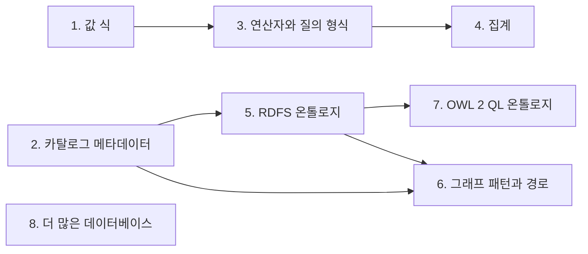

# sparql-v12n

[English](README.md) | 한국어 | [简体中文](README.zh-CN.md)

> 이 문서는 [README.md](README.md)(커밋 c9e8040)의 번역이다. 내용이 다르면 영어 원문을 따른다.

<p align="center"><b>Rust로 작성한 가상 지식 그래프 엔진이다. R2RML 매핑으로 SPARQL 질의를 SQL로 번역하고, 데이터를 복사하지 않고 원본 데이터베이스에서 실행한다.</b></p>

<p align="center">
  <picture>
    <source media="(prefers-color-scheme: dark)" srcset="docs/images/how-it-works-dark.svg">
    
  </picture>
</p>

- SPARQL 질의 하나는 SQL 질의 하나가 되고, 데이터가 있는 데이터베이스에서
  실행된다. 데이터는 복사하지 않는다.
- 현재는 PostgreSQL을 지원한다. 다른 데이터베이스는 [로드맵](#로드맵)에 있다.
- 어떤 테이블과 컬럼이 어떤 클래스와 속성이 되는지는 R2RML 매핑이 정한다. 매핑에
  없는 데이터는 질의할 수 없다.
- 온톨로지 추론은 아직 없다. 클래스를 찾는 질의는 매핑이 그 클래스로 밝힌 것만
  찾는다. [로드맵](#로드맵)을 참고한다.
- 실행 파일 `v12n` 하나가 명령줄 도구와 SPARQL 1.1 Protocol HTTP 엔드포인트를
  모두 제공한다.

> 상태: 실험 단계. 아래의 지원 범위는 Ontop 및 W3C R2RML 테스트 케이스와 대조해
> 확인한다. 1.0 이전에 명령, 출력, API가 바뀔 수 있다.

## 지원하는 SPARQL

엔진은 R2RML 매핑 하나와 PostgreSQL 데이터베이스 하나에 대한 `SELECT` 질의에
답한다. 아래 표는 지원하는 것과 거부하는 것을 정리한다. 거부 항목이나 표에 없는
형식의 질의는 오류로 끝난다(`v12n query`는 종료 코드 1, HTTP 엔드포인트는 501).
다른 답을 반환하는 일은 없다. 지원 기능은 모두 차등 테스트(`tests/diff`)에서
[Ontop](https://ontop-vkg.org/)과 비교한다.

| 기능 | 비고 | 거부 |
|---|---|---|
| Basic graph pattern | 상수 술어와 `rdf:type`. 상수와 공유 변수는 컬럼 타입이 달라도 RDF term으로 일치한다. triple은 그것을 만드는 행이 몇 개든 한 번으로 센다 | 변수 술어, property path, `GRAPH`, `FROM`, `FROM NAMED` |
| `SELECT`, `SELECT *`, `DISTINCT` | solution에 대한 bag 의미론 | `REDUCED`, `SELECT` 안의 식, `BIND`, 하위 질의, `GROUP BY`와 집계 |
| `OPTIONAL` | 중첩과 연속, 내부의 `FILTER`, 바인딩되지 않은 변수 | 여러 `OPTIONAL` 부분만 바인딩하는 변수에 대한 `SELECT DISTINCT`, 빈 쪽이 있는 `UNION`을 감싼 `OPTIONAL` 안의 `FILTER` |
| `UNION` | 양쪽의 bag 합집합, `OPTIONAL` 안에서도 지원. 한 변수에 대한 서로 다른 형태의 term map | 같은 변수에서 자연 datatype 컬럼과 다른 literal 형태 사이의 중복 제거 |
| `FILTER` | `=`, `!=`, `<`, `<=`, `>`, `>=`, `&&`, `\|\|`, `!`, `BOUND`, `sameTerm`, `isIRI`, `isBlank`, `isLiteral`, `STR`, `LANG`, `DATATYPE`, `REGEX`, SPARQL의 오류 의미론 적용 | 그 밖의 함수, 산술, `IN`, `EXISTS`. SPARQL 1.1이 확장에 맡긴 비교(`xsd:date` 순서 비교, language tag가 있는 literal에 대한 `!=`, 시간대가 있는 dateTime과 없는 dateTime의 비교). `real` 컬럼에 대한 비교. `\d`, `\w`, `\p{..}`, 역참조를 쓰는 `REGEX` |
| `ORDER BY`, `LIMIT`, `OFFSET` | SPARQL 1.1 순서, SPARQL이 정하지 않은 곳은 고정된 순서 | `SELECT DISTINCT`가 투영하지 않는 변수에 대한 `ORDER BY` |
| Literal | RDF 1.1 term 동등: language tag는 소문자, `xsd:string`은 simple literal, XSD 1.1 canonical lexical form | `FILTER`에서 값으로 비교하는 `xsd:float`와 파생 정수 타입 |
| 그 밖의 형태 | RDFS 추론 없음: `rdf:type`은 매핑이 명시한 클래스와 일치한다 | `ASK`, `CONSTRUCT`, `DESCRIBE`, `MINUS`, `VALUES`, `SERVICE` |

자세한 내용은 아래 절에 있다. `tests/diff/README.md`에는 Ontop과의 알려진 차이와,
거부되는 테스트 질의마다 거부되는 이유가 정리되어 있다.

## 인터페이스

| 인터페이스 | 용도 |
|---|---|
| `v12n` CLI | `check`, `terms`, `explain`, `query`, `serve` |
| HTTP | `/sparql`의 SPARQL 1.1 Protocol 엔드포인트 |

## `v12n query`

`v12n query mapping.ttl query.rq --db postgresql://reader@localhost/shop`는
SPARQL 질의를 실행하고 그 결과를 다음 세 형식 중 하나로 출력한다.

- SPARQL 1.1 Query Results JSON.
- `--format csv`를 주면 SPARQL 1.1 Query Results CSV. CSV에는 lexical form만
  들어가며, 바인딩되지 않은 변수는 빈 필드다.
- `--format table`을 주면 표.

질의는 다음 세 곳에서 읽는다.

- 위 예의 `query.rq` 같은 파일
- 파일 이름 대신 `-`를 주면 stdin
- `--query '<SPARQL>'`를 주면 명령줄

이 형식들에는 결과를 부분 결과로 표시하는 방법이 없다. 따라서 명령은 제한에 걸린
사실을 결과 밖의 stderr와 종료 코드로 알린다.

| 종료 코드 | 조건 |
|---|---|
| `0` | 성공. 결과가 정확히 `--row-limit` 행인 경우도 포함한다 |
| `1` | 잘못된 입력: 인자, 파일, 질의 문법, 미지원 SPARQL |
| `2` | 잘못된 매핑 |
| `3` | 데이터베이스 오류, 또는 RDF term이 될 수 없는 값 |
| `4` | statement timeout(`--timeout`). 첫 행 전의 timeout은 다른 오류처럼 보고한다. 출력이 시작된 뒤의 timeout은 stdout의 JSON을 닫히지 않은 채로 남긴다(CSV에는 끝 표시가 없다) |
| `5` | 행 제한 도달(`--row-limit`). stdout에는 처음 `--row-limit`개의 solution이 완결된 결과로 들어 있고, stderr에는 경고가 있다 |

stderr 줄은 원인과 제한값을 밝힌다. 예를 들어 잘린 결과는
`warning: result truncated at the row limit of 10000; more rows exist ...`를
출력하고, timeout은
`error: statement timeout of 30s reached after 120 rows; ...`를 출력한다.

## 에이전트용 CLI

CLI는 사람이 직접 쓰는 것뿐 아니라 셸 도구가 호출하는 것도 고려해 만들었다.
CLI는 다음 규칙을 따른다.

- 입력을 묻지 않는다.
- stdout이 터미널이 아니면 항상 JSON을 출력한다. `--format json`은 JSON 출력을
  강제한다.
- 색은 터미널에서만 쓰며, `NO_COLOR`가 설정되어 있으면 쓰지 않는다.
- 모든 명령이 위의 종료 코드를 쓴다.

호출하는 쪽은 매핑에서 답까지 세 단계로 진행한다.

1. `v12n terms mapping.ttl`은 매핑이 노출하는 클래스와 속성을 나열한다. 그 밖의
   클래스나 속성은 일치할 수 없다.

   ```json
   {"prefixes":{"ex":"http://example.org/"},
    "classes":[{"iri":"http://example.org/Customer","prefixed_name":"ex:Customer","triples_maps":["<#CustomerMap>"]}, ...],
    "properties":[{"iri":"http://example.org/name","prefixed_name":"ex:name","triples_maps":["<#CustomerMap>"]}, ...]}
   ```

2. `v12n explain mapping.ttl --query '<SPARQL>'`은 데이터베이스 없이 질의를
   검사한다. 문법 오류나 미지원 기능이 있으면 1로 종료한다. 성공하면 SQL, 그
   바인딩 parameter, 투영되는 변수를 출력한다.

   ```json
   {"sql":"SELECT DISTINCT t0.\"id\" AS \"customer\", ...","params":["VIP"],
    "variables":[{"name":"customer","term_type":"iri","columns":["customer"]}, ...]}
   ```

3. `v12n query mapping.ttl --query '<SPARQL>'`는 질의를 실행하고 SPARQL 1.1
   Query Results JSON을 출력한다. 데이터베이스는 `--db`나 `V12N_DATABASE_URL`로
   지정한다. 행 제한, statement timeout, 읽기 전용 세션은 기본으로 켜져 있다.

출력 전에 발생한 오류는 결과 대신 stdout에 JSON 객체 하나로 출력된다. 따라서
호출하는 쪽은 종료 코드를 확인한 뒤 어느 경우든 stdout을 읽는다.

```json
{"ok":false,"error":{"kind":"query","message":"query syntax error: ...","exit_code":1}}
```

아래 표는 각 오류 `kind`와 그 종료 코드, 그리고 있는 경우 그 `details`를
나열한다.

| `kind` | 종료 코드 | `details` |
|---|---|---|
| `input`, `query`, `unsupported`, `output`, `runtime` | 1 | 파일을 읽을 수 없을 때 `{"path": ...}` |
| `mapping` | 2 | |
| `database`, `data` | 3 | |
| `timeout` | 4 | `{"timeout_ms": ..., "rows": ...}` |

일부 오류는 stdout 대신 stderr에 `error: ...` 한 줄로 출력된다.

- 결과 출력이 시작된 뒤의 오류. 이 오류는 stdout을 더 이상 바꿀 수 없기 때문이다
- `--format csv`나 `--format table`에서의 모든 오류

행 제한 `warning: ...`(종료 코드 5)은 항상 stderr로 출력된다.

`v12n <command> --help`는 각 명령의 JSON과 CSV 형태를 나열한다. 그 예제는 저장소
루트에서 실행된다.

## HTTP 엔드포인트

`v12n serve --config v12n.toml`은 `/sparql`에서 SPARQL 1.1 Protocol을 제공한다.
생존 확인용 `/healthz`도 제공한다.

요청은 다음 세 방식 중 하나로 질의를 보낸다.

- `GET /sparql?query=...`
- `application/x-www-form-urlencoded`(`query=...`)를 쓰는 `POST`
- `application/sparql-query`를 쓰고 질의를 본문으로 보내는 `POST`

결과는 SPARQL 1.1 Query Results JSON(`application/sparql-results+json`)이다.
결과는 PostgreSQL에서 행이 도착하는 대로 스트리밍된다. 다른 형식을 요청하면
`406`을 반환한다.

`default-graph-uri`와 `named-graph-uri` parameter는 `400`을 반환한다. 데이터셋은
매핑이 정의한 것이기 때문이다.

| 상태 | 조건 |
|---|---|
| `200` | 결과. 행 제한이 적용되어 결과가 잘리면 응답에 `V12N-Truncated: <row limit>`가 붙고, 응답은 정확히 그 수만큼의 solution을 담는다. 같은 경우 `v12n query`는 5로 종료한다 |
| `400` | 질의 문법 오류, `query`가 없거나 반복됨, 데이터셋 parameter, 너무 많은 SQL branch로 unfold되는 질의 |
| `406` / `413` / `414` / `415` | `406`: 제공하지 않는 형식. `413`: `POST`에서 `max_query_bytes`를 넘는 질의. `414`: `GET`에서 `max_query_bytes`를 넘는 질의. `415`: 그 밖의 content type |
| `501` | 아직 지원하지 않는 SPARQL 기능 |
| `503` | 첫 행 전의 statement timeout(이 경우 `v12n query`는 4로 종료한다), 또는 `max_concurrent_requests` 도달(응답에 `Retry-After`가 붙는다) |
| `500` | 데이터베이스 오류나 그 밖의 내부 오류 |

상태는 본문보다 먼저 전송된다. 따라서 첫 행 이후의 오류는 상태를 바꿀 수 없다.
이때 서버는 응답을 중단하고 오류를 로그에 남기며, JSON은 닫히지 않은 채로
남는다.

결과가 잘리는지는 첫 행 전에 알 수 있다. PostgreSQL이 행을 보내기 전에
제한까지의 행 수를 세기 때문이다.

설정은 `--config`로 지정한 TOML 파일에서 읽는다. 예는 다음과 같다.

```toml
[server]
address = "127.0.0.1"
port = 7878

[database]
url = "postgresql://reader@localhost/shop"
password_env = "SHOP_DB_PASSWORD"   # optional: read the password from this variable

[mapping]
path = "mapping.ttl"                # relative to this file
base_iri = "http://data.example.com/"   # optional: for relative IRIs (see below)

[limits]
statement_timeout = "30s"           # 0 disables
row_limit = 10000                   # 0 disables
max_query_bytes = 65536
max_concurrent_requests = 16        # more are refused with 503, not queued
```

환경 변수는 파일의 설정을 덮어쓴다. 다음 표는 각 설정과 그 환경 변수, 기본값을
나열한다.

| 설정 | 환경 변수 | 기본값 |
|---|---|---|
| `[server] address` | `V12N_ADDRESS` | `127.0.0.1` |
| `[server] port` | `V12N_PORT` | `7878` |
| `[database] url` | `V12N_DATABASE_URL` | 필수 |
| `[database] password_env` | (파일 전용) | 없음 |
| `[mapping] path` | `V12N_MAPPING` | 필수 |
| `[mapping] base_iri` | `V12N_BASE_IRI` | 없음: 상대 IRI는 데이터 오류 |
| `[limits] statement_timeout` | `V12N_STATEMENT_TIMEOUT` | `30s` |
| `[limits] row_limit` | `V12N_ROW_LIMIT` | `10000` |
| `[limits] max_query_bytes` | `V12N_MAX_QUERY_BYTES` | `65536` |
| `[limits] max_concurrent_requests` | `V12N_MAX_CONCURRENT_REQUESTS` | `16` |

다른 명령도 같은 변수의 일부를 읽는다.

- `v12n query`는 `V12N_DATABASE_URL`, `V12N_ROW_LIMIT`,
  `V12N_STATEMENT_TIMEOUT`, `V12N_BASE_IRI`를 읽는다. 명령줄 옵션이 이
  변수들보다 우선한다.
- `v12n explain`은 `V12N_BASE_IRI`를 읽는다.

`serve`에서는 `--base-iri` 옵션도 base IRI 설정을 덮어쓴다. `serve`는 그 밖의
`V12N_*` 변수를 무시한다. 변수마다 경고를 로그에 남기므로 이름을 잘못 쓰면
드러난다.

읽기만 할 수 있는 데이터베이스 사용자로 접속한다. 엔진도 세션을 읽기 전용
트랜잭션으로 설정한다.

데이터베이스 URL과 비밀번호는 로그에 남기지 않는다. 요청 로그는 `RUST_LOG`로
정한 레벨에 따라 stderr에 기록된다. 요청 로그에는 생성된 SQL과 소요 시간이
기록되고 결과 값은 기록되지 않는다.

TLS, 인증, CORS는 서버 앞단의 리버스 프록시가 담당한다.

## 컬럼 이름

`rr:column`, 템플릿, join 조건의 컬럼 이름은 SQL 식별자다(R2RML §5). 컬럼 이름은
다음 두 방식 중 하나로 해석된다.

- `"\"Name\""` 같은 구분 식별자는 쓴 그대로 받는다.
- 일반 이름은 PostgreSQL이 따옴표 없는 이름을 해석하는 방식대로 해석된다. 이때
  이름은 소문자로 바뀐다.

예를 들어 `rr:column "StudentId"`는 `SELECT ... AS StudentId`가 만드는 컬럼인
`studentid`를 읽는다. 같은 이유로 `rr:column "Name"`은 `"Name"`으로 만든 컬럼과
일치하지 않는다.

일반 이름을 쓰는 질의를 실행하기 전에 엔진은 PostgreSQL이 그 이름을 해석하는
probe 문을 준비한다. 그런 뒤 해석된 이름을 생성 SQL에서 따옴표로 감싼다. 소문자,
숫자, `_`로만 된 이름에는 probe가 필요 없다.

## 상대 IRI

`rr:termType rr:IRI`를 가진 컬럼이나 템플릿은 `Carlos`나 `person/7` 같은 상대
IRI를 만들 수 있다. R2RML은 상대 IRI를 프로세서에 주어진 base IRI를 기준으로
해석한다(R2RML §4, §11.2).

이 해석은 RFC 3986 해석이 아니라 단순한 문자열 연결이다. 예를 들어 base가
`http://data.example.com/`이면 다음과 같다.

- `Carlos`는 `<http://data.example.com/Carlos>`가 된다.
- `../x`는 `<http://data.example.com/../x>`가 된다.

템플릿 값은 먼저 퍼센트 인코딩된다. 예를 들어 `Bob/Charles`는 `Bob%2FCharles`가
된다.

기본 base IRI는 없다. base IRI는 `base_iri`, `--base-iri`, `V12N_BASE_IRI`로
설정한다. 이 설정이 없으면 상대 IRI는 R2RML 데이터 오류가 되며, 오류는 이 설정의
이름을 밝힌다. 이 방식으로 엔진은 데이터의 IRI를 임의로 만들어 내지 않는다. base
IRI는 데이터가 속한 네임스페이스로 설정한다. 이 값은 절대 IRI여야 한다.

문자열이 `http:`나 `urn:` 같은 스킴으로 시작하면 절대 IRI로 본다. 프래그먼트가
있다고 상대 IRI가 되지는 않는다.

스킴이 있지만 유효한 IRI가 아닌 문자열은 데이터 오류다. R2RML에 따르면 이런
문자열에는 base IRI를 앞에 붙인 IRI를 먼저 시도한다. 두 규칙의 차이는 포트가
숫자가 아닌 `http://host:port/` 같은 값에서만 생긴다. 엔진의 규칙 덕분에 아래의
SQL 비교가 결과와 같은 규칙을 쓸 수 있다.

- `{name}`이나 `person/{id}`처럼 텍스트에서 스킴이 생길 수 없는 템플릿에는
  매핑을 읽을 때 base IRI를 앞에 붙인다. 그러면
  `<http://data.example.com/person/7>` 같은 상수는 이전처럼 컬럼에서 일치 여부를
  검사하며(`id = $1`), 컬럼의 index를 쓴다.
- 컬럼에는 상대 형태와 절대 형태 중 어느 쪽이든 들어 있을 수 있다. 따라서 상수는
  두 형태 모두와 일치한다. `http://data.example.com/a`와 `a`를 넣은
  `iri IN ($1, $2)`가 그 예다. 이 조건도 컬럼의 index를 쓴다.
- 이런 컬럼에 대한 join은 생성된 IRI를 SQL에서 비교한다. 값에 따라 스킴이
  달라지는 `{scheme}:{rest}` 같은 템플릿에 대한 join도 마찬가지다. 비교는
  `CASE WHEN iri ~ '^scheme:' THEN iri ELSE $base || iri END` 형태다. 이
  비교에는 컬럼의 index를 쓸 수 없다.
- 중복은 컬럼 값으로 제거한다. 따라서 `a`와 `http://data.example.com/a`처럼 상대
  값과 그것이 해석된 절대 IRI는 여전히 두 번 센다. 이런 이유로 base IRI가
  설정되어 있으면 이런 컬럼에 대한 `SELECT DISTINCT`는 미지원으로 거부된다.

참고로 Ontop 5.5.0은 절대 IRI로 시작하지 않는 모든 템플릿 앞에 W3C 테스트
케이스의 base IRI인 `http://example.com/base/`를 붙인다. Ontop에는 이 base를
바꾸는 설정이 없다. 또한 Ontop은 컬럼에서 온 상대 IRI에서 실패한다.

## 컬럼 값의 lexical form

엔진은 문자열이 아닌 모든 값을 canonical form으로 쓴다. canonical form은 XML
Schema 1.1 Part 2가 정의하는 형태이며, 이 버전이 R2RML이 참조하는 버전이다. 이
규칙은 literal과 템플릿 값 모두에 적용된다.

- `numeric` 12.50과 3.00은 `"12.5"^^xsd:decimal`과 `"3"^^xsd:decimal`이 된다.
  정수 값인 decimal에는 소수점이 없다.
- `float8` 30은 `"3.0E1"^^xsd:double`이 된다.
- `boolean`은 `true`/`false`가 된다.
- `bytea`는 대문자 16진수가 된다.

따라서 결과는 컬럼에 선언된 스케일에 좌우되지 않는다.

Ontop은 대신 PostgreSQL의 텍스트 출력(`12.50`, `"30"^^xsd:double`)을 쓴다. 차등
테스트는 이를 알려진 차이로 기록한다(이슈 #25).

SQL `=`가 다르다고 판단하는 두 값이 하나의 term일 수 있다. PostgreSQL은
`time '24:00:00'`과 `'00:00:00'`을 구분한다. XSD 1.1은 둘을 같은 값에 대응시키고
`00:00:00`으로 쓴다. 두 값 모두 `"00:00:00"^^xsd:time`이 되며, 그 결과는 다음과
같다.

- 상수 `"00:00:00"^^xsd:time`은 둘 모두와 일치한다.
- 상수 `"24:00:00"^^xsd:time`은 어느 것과도 일치하지 않는다.
- join, `DISTINCT`, `UNION`, `ORDER BY`는 둘을 하나의 값으로
  다룬다(`col + interval '0'`).

`time` 컬럼의 유일 키는 질의에 중복이 없음을 증명하는 데 쓰지 않는다. Ontop은
`24:00:00`을 그대로 쓴다(이슈 #37).

SQL `=`가 같다고 판단하는 두 값이 서로 다른 term일 수도 있다. 다음이 그런
경우다.

- `real`과 `double precision` 컬럼에서 `-0`과 `0`은 `"-0.0E0"`과 `"0.0E0"`이
  된다.
- `char(n)` 값은 채움 공백을 유지하는데, `char(n)`에 대한 `=`는 이 공백을
  무시한다. 예를 들어 `'a'::char(3)`은 `"a  "`가 된다.

엔진은 상수, join, `sameTerm`, `DISTINCT`와 `UNION`이 제거하는 중복에서 이런
컬럼을 term으로 비교한다. 이런 곳에서는 값의 텍스트(0인 경우)나 길이(`char(n)`인
경우)도 비교한다. 엔진은 이 비교를 `=` 옆에 두므로, 컬럼의 index로 여전히 행을
찾을 수 있다.

## 질의 안의 상수

triple pattern 안의 상수는 SPARQL이 요구하는 대로 RDF term으로 일치 여부를
판단한다. lexical form과 datatype이 모두 같아야 한다. 컬럼 값은 R2RML 자연
매핑으로 비교에 참여한다. 예를 들어 `integer` 컬럼은 canonical form의
`xsd:integer`를, `numeric`은 canonical `xsd:decimal`을 만들며, 다른 타입도 같은
방식이다.

다음 표는 7을 담은 integer 컬럼과 일치하는 상수를 보여 준다.

| 상수 | 일치 | 이유 |
|---|---|---|
| `7`, `<…/customer/7>` | 예 | |
| `"7"`, `"7"^^xsd:decimal`, `7.0` | 아니오 | datatype이 다르다 |
| `"07"^^xsd:integer`, `<…/customer/007>`, `<…/customer/+7>` | 아니오 | 상수가 매핑이 만드는 canonical form이 아니다 |
| `99999999999`, `<…/customer/99999999999>` | 아니오 | 값이 컬럼의 범위를 벗어나므로 이 값을 가진 행이 없다 |

상수는 SQL 텍스트 안에 넣지 않고 항상 바인딩된 parameter로 PostgreSQL에 보낸다.

바인딩 전에 엔진은 각 상수를 PostgreSQL이 컬럼에서 추론한 parameter 타입과
대조한다. 대조는 다음 단계로 이루어진다.

1. 엔진은 상수를 그 타입으로 읽는다.
2. 결과 term을 만드는 코드와 같은 코드로 값을 다시 형식화한다.
3. round trip 결과가 동일할 때만 상수를 보낸다. 타입이 허용하면 상수를
   바이너리로 보낸다.

일치할 수 없는 상수는 자신이 속한 `UNION` branch를 비운다. 엔진은 PostgreSQL이
해석할 수 없는 입력으로 실패하게 하는 대신 이렇게 처리한다. `OPTIONAL` 부분
안에서는 그 부분만 일치하지 않으며, 그 왼쪽의 solution은 유지된다. 남은 branch가
없으면 질의를 데이터베이스에 보내지 않는다.

비교는 컬럼 자체의 타입으로 이루어지므로 컬럼의 index를 쓴다.

`interval`처럼 자연 datatype이 없는 컬럼 타입이 있다. 이런 타입에서는 결과에
텍스트로 캐스트한 컬럼이 담긴다. 상수는 같은 텍스트와
비교한다(`col::text = $1`). 이 비교에는 컬럼의 index를 쓸 수 없다.

## Literal

literal은 어디서나 RDF 1.1 term으로 비교한다. triple pattern, join, `sameTerm`,
RDFterm-equal을 뜻하는 경우의 `FILTER` 안 `=`, `DISTINCT`, 결과가 모두 해당한다.

- language tag는 대소문자를 구분하지 않고 비교한다(RDF 1.1 Concepts §3.3).
  따라서 엔진은 language tag를 소문자로 유지한다. 예를 들어
  `rr:language "EN-us"`는 `"chat"@en-us`가 되고, 상수 `"chat"@EN-US`는 이와
  일치한다. tag의 대소문자만 다른 두 term map은 하나의 term을 만든다. 유효한 BCP
  47 language tag가 아닌 tag는 매핑 오류다(R2RML §7.5).
  `rr:datatype rdf:langString`도 매핑 오류다. `rdf:langString`은 tag가 있는
  문자열 전용 datatype이기 때문이다.
- simple literal은 `xsd:string` literal이다. `"x"`, `"x"^^xsd:string`, text
  컬럼, `rr:datatype xsd:string`을 가진 컬럼, literal 템플릿은 모두 같은 term을
  만든다. 결과는 이 term을 datatype 없이 쓴다. `DATATYPE`은 `xsd:string`을
  반환한다.
- 어떤 term map도 만들지 않는 datatype은 triple pattern에서 결코 일치하지
  않는다. 예를 들어 integer 컬럼은 `xsd:integer` term을 만들므로
  `"5"^^xsd:int`와 `"5"^^xsd:decimal`은 그 패턴에서 아무것과도 일치하지 않는다.
  사용자 정의 datatype도 그 패턴에서 아무것과도 일치하지 않는다. `FILTER`에서는
  숫자를 값으로 비교하며, `xsd:float`와 파생 정수 타입은 거부한다(`FILTER`
  참고).
- `char(n)` 값은 RDF term에서 뒤쪽 채움 공백을 유지한다. SQL 표준과 W3C RDB2RDF
  기대 출력이 이렇게 정한다(D018: `"Venus          "`). 채움 공백이 없는 값이
  필요하면 `varchar`나 `text`, 또는 `rtrim()`을 쓰는 R2RML 뷰를 사용한다.

datatype을 넘나드는 값 비교는 `FILTER`가 다룬다(아래 참고). integer 컬럼에 대한
`FILTER(?amount = 7.0)`이 그 예다.

## 여러 컬럼이 공유하는 변수

두 번 나타나는 변수는 join이다. join도 SQL 값이 아니라 RDF term을 비교한다.

이런 질의를 실행하기 전에 엔진은 관련 컬럼의 타입을 PostgreSQL에 묻는다. 이를
위해 probe 문을 준비한다. 그 결과에 따라 엔진은 다음과 같이 처리한다.

- 같은 종류의 컬럼(정수, 텍스트, 날짜, ...)은 `=`로 비교하므로 index를 쓴다.
- 그 밖의 쌍은 SQL에서 계산한 자연 lexical form으로
  비교한다(`int_col::text = text_col::text`). 이때 먼저 자연 datatype을
  확인한다. 예를 들어 7을 담은 `integer` 컬럼은 text 컬럼에
  `rr:datatype xsd:integer`가 있을 때만 그 컬럼과 join된다. `numeric` 7.0과는
  결코 join되지 않는다. `numeric` 값의 canonical form은
  `trim_scale(col)::text`(PostgreSQL 13 이상)로 계산한다. 이 형태가 엔진 자체의
  형식화와 같은지는 테스트로 확인한다.
- 템플릿이나 IRI 컬럼을 문자열로만 비교할 수 있을 때는 템플릿 값을 IRI와 같은
  방식으로 퍼센트 인코딩한다(R2RML IRI-safe version).
- SQL에서 lexical form을 계산할 수 없으면 질의를 미지원으로 거부한다(종료 코드
  1, HTTP 501). text 컬럼과 비교하는 `float8`이나 날짜/시간 템플릿 값이 그 예다.
  엔진은 PostgreSQL에서 실패하거나 틀린 행을 반환하는 대신 이런 질의를 거부한다.

## 타입이 다른 컬럼에 걸친 변수

한 패턴의 term map들은 SQL 타입이 다른 컬럼에서 변수를 읽을 수 있다. 예를 들어
변수는 한 triples map에서는 `integer` 컬럼에서, 다른 triples map에서는 `text`
컬럼에서 올 수 있다.

`UNION`은 결과 컬럼마다 타입이 하나여야 한다. 따라서 여러 term map에 걸친
질의에서는 엔진이 선택된 컬럼의 타입도 PostgreSQL에 묻는다. 그 결과에 따라
엔진은 다음과 같이 처리한다.

- 값을 바꾸지 않고 타입을 합칠 수 있으면 결과 컬럼 하나를 유지한다. `int4`와
  `int8`, `text`와 `varchar`가 그 예다.
- 자연 datatype의 literal은 datatype마다 결과 컬럼 하나로 나눈다. 각 branch는
  자기 컬럼을 채우고 나머지는 `NULL`로 둔다. 그 결과 정수 120은
  `"120"^^xsd:integer`로, 텍스트 `'120'`은 `"120"`으로 유지된다.
- 두 타입이 같은 term을 만들 수 있으면, join과 마찬가지로 SQL에서 계산한 자연
  lexical form을 선택한다. 그러면 두 term map에서 온 같은 triple도 한 번으로
  센다. 다음 term이 이에 해당한다.
  - 템플릿 값(`integer` 키와 `text` 키에 대한 `item/{id}`는 둘 다 `item/1`이
    된다)
  - IRI 컬럼
  - `rr:datatype`이나 language tag가 있는 literal
  - `text`와 `uuid` 컬럼의 plain literal
- 그 형태를 SQL에서 계산할 수 없으면 질의를 미지원으로 거부한다. `float8`,
  `double precision`과 함께 쓰인 `real`, 날짜/시간, `char(n)`이 이에 해당한다.

## 중복 triple

RDF 그래프는 triple의 set이다. 따라서 triple은 그것을 만드는 행이 몇 개든 한
번으로 센다. 다음 경우에 여러 행이 같은 triple을 만들 수 있다.

- 키가 없는 테이블의 중복 행
- 행을 반복하는 R2RML 뷰
- 같은 triple을 만드는 두 term map

basic graph pattern은 모든 변수의 서로 다른 바인딩마다 solution 하나를 가진다.
`SELECT`는 그다음에야 투영한다. 따라서
`SELECT ?city WHERE { ?p ex:city ?city }`는 여전히 사람마다 도시를 한 번씩
반환한다.

생성 SQL은 `DISTINCT`로, term map 사이에서는 `UNION`으로 중복을 제거한다. 이
제거는 패턴의 모든 변수의 컬럼에 대해 이루어진다. 그 변수 중 선택되지 않은 것이
있으면 하위 질의 안에서 제거한다.

일부 질의는 (`UNION`의 어느 한쪽에서) term map 조합 하나로 테이블(뷰가 아닌)을
읽는다. 이런 질의를 실행하기 전에 엔진은 카탈로그에서 그 테이블들의 유일 키를
읽는다. 모든 테이블이 solution이 고정하는 컬럼 중에 키를 가지면 두 행이 같은
solution을 만들 수 없다. 이때 SQL은 `DISTINCT` 없이 모든 행을 유지한다.

그렇지 않으면 PostgreSQL이 중복을 제거해야 한다. 여기에는 행 전체에 대한 해시나
정렬 비용이 든다. index가 행을 순서대로 넘겨주지 않는 한, PostgreSQL은 첫 행을
반환하기 전에 모든 행을 읽기도 한다.

`v12n explain`은 데이터베이스가 없으므로 항상 `DISTINCT`를 보여 준다.

중복은 컬럼 값으로 비교한다. 따라서 템플릿이 같은 문자열로 만드는 서로 다른 두
값은 여전히 두 번 센다. 예를 들어 템플릿 `{a}-{b}`는 값 `x-`, `y`와 값 `x`,
`-y`를 같은 문자열로 만든다.

선택되지 않은 변수는 그 컬럼의 타입과 텍스트 출력으로 비교한다. 따라서 다음
경우에는 같은 term도 여전히 두 번 셀 수 있다.

- SQL이 lexical form을 계산할 수 없는, 타입이 다른 컬럼
- `varchar`와 `text`처럼 타입이 합쳐지는 컬럼
- `numeric` 1.0과 1.00처럼 텍스트 출력이 다른 같은 타입의 값

## OPTIONAL

`OPTIONAL`은 SPARQL algebra의 LeftJoin을 따른다. 왼쪽의 모든 solution은 유지된다.
optional 부분에 호환되는 solution이 있으면 왼쪽 solution을 그 각각으로 확장한다.
SQL은 optional 부분마다 `LEFT JOIN`을 하나씩 쓴다.

- 부분의 테이블은 서로 join한다. 여러 개면 괄호로 묶는다. `ON` 절에는 부분
  자체의 조건과 왼쪽과의 연결 조건을 둔다.
- 중첩된 `OPTIONAL`은 바깥 `LEFT JOIN` 안의 `LEFT JOIN`이다. `OPTIONAL` 뒤에 쓴
  패턴은 그 뒤에 join한다.
- 공유 변수는 join과 마찬가지로 RDF term으로 비교한다. 따라서 타입이 있는 컬럼과
  템플릿 분해도 같은 방식으로 동작한다. 양쪽이 모두 단순 컬럼이면 index를 쓴다.
- 바인딩되지 않은 변수는 SQL에서 `NULL`이고 JSON 바인딩에서는 빠진다.
- 공유 변수가 한쪽에서 바인딩되지 않을 수 있다. 앞선 `OPTIONAL`만, 또는 부분
  안에 중첩된 `OPTIONAL`만 그 변수를 바인딩하는 경우다. 이런 변수는 어떤 값과도
  호환된다. 이때 조건은 `(left IS NULL OR left = right)`이며, 이 조건에는 컬럼의
  index를 쓸 수 없다.
- algebra가 평가하는 방식대로 각 부분을 먼저 따로 변환한다. 따라서 중첩된 부분을
  바깥 왼쪽과 연결하는 조건은 바깥 부분의 `ON` 절에서 검사한다. 이 조건을 중첩된
  부분 안에서 검사하는 일은 없다.
- `OPTIONAL` 부분만 바인딩하는 변수는 그 각 부분에서 컬럼을 받는다. 그 값은
  행에서 처음 바인딩된 값이다.
- optional 부분의 상수 term에는 플래그 컬럼이 붙는다. 이 플래그는 그 부분이
  일치했는지 알려 준다.
- 다른 basic graph pattern과 마찬가지로 중복 triple은 각 부분 안에서 한 번으로
  센다.

optional 부분은 둘 이상의 방식으로 일치할 수 있다. 둘 이상의 triples map 조합이
그 부분과 일치할 수 있거나, 그 안의 `UNION`에서 둘 이상의 쪽이 일치할 수 있는
경우다. 이때 그 부분은 그 선택지들의 합집합이며, algebra에서 다음 항등식이
성립한다.

LeftJoin(L, R1 ∪ R2)는 Join(L, R1) ∪ Join(L, R2) ∪ Diff(L, R1 ∪ R2)다.

SQL branch도 이에 따라 나뉜다.

- 선택지마다 branch 하나. 이 branch는 그 선택지의 `LEFT JOIN`과, 그 부분이
  일치했다는 `WHERE` 조건을 가진다. PostgreSQL은 이를 inner join으로 바꾼다.
- 모든 선택지의 `LEFT JOIN`과, 어느 것도 일치하지 않았다는 `WHERE` 조건을 가진
  branch 하나. 이 branch는 anti-join이다. 이 branch는 아무것도 확장하지 않는
  왼쪽 solution을 유지한다.

각 부분은 자기 `ON` 절을 유지한다. 따라서 부분이 하나일 때와 마찬가지로, 부분이
일치하는지는 호환성과 `OPTIONAL` 안의 `FILTER`가 결정한다. 바깥 부분 안에서는
이렇게 나뉜 branch가 바깥 부분의 선택지가 된다. 빈 쪽이 있는 `UNION`은 그 쪽을
거쳐 모든 왼쪽 solution을 바뀌지 않은 채로 확장한다.

다음은 아직 지원하지 않으며 미지원으로 거부한다.

- 여러 `OPTIONAL` 부분만 바인딩하는 변수에 대한 `SELECT DISTINCT`
- 빈 쪽이 있는 `UNION`을 감싼 `OPTIONAL` 안의 `FILTER`

## UNION

`{ A } UNION { B }`는 양쪽의 solution을 bag으로 가진다. 양쪽이 모두 만드는
solution은 두 번 센다. `SELECT DISTINCT`에서는 한 번 센다. 한쪽만 바인딩하는
변수는 다른 쪽의 solution에서 바인딩되지 않는다.

- join, `FILTER`, `OPTIONAL`은 왼쪽에 있는 합집합에 대해 분배된다. **arm**은
  모든 `UNION`에서 한쪽씩 고른 조합이다. 이 분배 때문에 엔진은 각 arm을 따로
  unfold하고 arm들을 `UNION ALL`로 합친다.
- 각 arm은 다른 패턴과 똑같이 변환된다. 중복 triple은 arm 안에서 한 번으로 센다.
  arm은 `DISTINCT`나 term map 사이의 `UNION`을 쓰고, 키로 중복이 없음이 증명되면
  아무것도 쓰지 않는다. 키는 arm마다 따로 검사한다. arm끼리는 결코 서로 비교하지
  않는다.
- 각 arm은 term map 조합마다 SQL branch 하나를 가진다. 모든 arm의 branch를 합한
  수는 64로 제한되며, 이는 한 패턴의 branch에 대한 제한과 같다.
- 한쪽 안의 `FILTER`는 그쪽의 solution에만 적용된다. 합집합을 감싼 그룹의
  `FILTER`는 양쪽의 solution 모두에 적용된다. 이 solution에서 다른 쪽의 변수는
  바인딩되지 않은 상태다.
- `OPTIONAL` 안의 `UNION`은 left join에 대해 분배되지 않는다. 그 양쪽은 optional
  부분의 선택지다(`OPTIONAL` 참고). 각 쪽의 solution은 자기 arm에 남는다.

변수는 형태가 다른 term map에서 값을 받을 수 있다. 형태는 합집합의 양쪽
사이에서, 또는 term map 사이에서 다를 수 있다.

- 한쪽은 템플릿이고 다른 쪽은 컬럼이나 다른 템플릿인 경우
- 상수, IRI, literal
- datatype이나 language tag가 다른 literal

결과는 각 값을 그 행을 만든 branch의 term map으로 다시 만든다. 경우는 두 가지다.

- 결코 같아질 수 없는 형태의 term은 별도의 결과 컬럼을 받는다. 각 branch는 자기
  컬럼을 채운다. 이 컬럼들에 대한 중복 제거는 정확하게 유지된다. 이런 형태는
  다음과 같다.
  - `http://example.org/customer/{id}`와 `http://example.org/wholesale/{code}`
    같은 두 템플릿. 고정 텍스트가 다르거나, 한쪽에 상대 쪽 값에서는 IRI-safe
    인코딩이 항상 이스케이프하는 텍스트가 있는 경우다
  - IRI와 literal
  - 서로 다른 두 상수
  - 두 language tag
- 같은 term을 만들 수 있는 형태들은, 한 arm 안에서나 `SELECT DISTINCT`에서
  중복을 비교할 때 결과 컬럼 하나를 공유한다. 이 컬럼은 term의 문자열을 담는다.
  SQL은 join과 마찬가지로 이 문자열을 계산한다(IRI-safe 템플릿, base IRI
  기준으로 해석한 IRI, 자연 lexical form). 그래서 템플릿에서 온 triple과 IRI
  컬럼에서 온 같은 triple은 한 번으로 센다. 이런 컬럼은 index를 쓸 수 없고,
  문자열은 모든 행에서 계산된다. 이 경우는 다음 두 상황에서 미지원으로 거부한다.
  - join과 마찬가지로 SQL이 lexical form을 계산할 수 없는 경우
  - 형태 중 하나가 자연 datatype의 컬럼인 literal. 이 컬럼의 datatype은 SQL
    타입에 따라 정해진다

## FILTER

`FILTER`는 오류까지 포함해 SPARQL의 평가 규칙을 따른다. 오류는 참도 거짓도
아니다. `error || true`는 참, `error && false`는 거짓이고, `!error`는 여전히
오류다.

SQL은 오류를 `NULL`로 나타낸다. SQL의 `AND`, `OR`, `NOT`도 `NULL`을 같은
방식으로 다룬다. `WHERE`는 필터가 참인 행만 유지한다. SPARQL이 오류로 만드는
비교는 SQL에서 `false`가 아니라 항상 `NULL`이다. 따라서 `FILTER(!(?x = 5))`는
`?x`가 바인딩되지 않았거나 문자열인 행을 제외한다.

필터의 적용 범위는 다음과 같다.

- 그룹 안의 `FILTER`는 그룹 안에서 쓴 위치와 관계없이 그룹 전체에 적용된다. 이
  필터는 그 그룹의 변수만 본다. 예를 들어
  `{ ?s ex:name ?n { ?s ex:qty ?q FILTER(?n = "x") } }`에서 필터는 오류다.
  중첩된 그룹 안에서 `?n`이 바인딩되지 않기 때문이다.
- `OPTIONAL` 안의 `FILTER`는 그 부분의 `LEFT JOIN`의 `ON` 절에 들어간다. 이
  필터는 부분이 일치하는지를 결정한다. 왼쪽의 어떤 행을 유지할지는 결정하지
  않는다. 이 필터는 왼쪽의 변수를 본다. 필터가 오류이면 SQL의 `LEFT JOIN`과
  마찬가지로 그 부분은 일치하지 않는다.
- `OPTIONAL` 뒤의 `FILTER`는 `WHERE`에 들어가 행을 제외한다.
- 바인딩되지 않은 변수는 `BOUND`를 제외한 모든 함수에서 오류다.
- `OPTIONAL` 부분만 바인딩하는 변수는 일치한 부분에서
  읽는다(`CASE WHEN part matched THEN ... END`).

비교는 SPARQL 연산자 매핑을 따른다.

| 피연산자 | `=`, `!=`, `<`, `<=`, `>`, `>=` |
|---|---|
| 숫자(`xsd:integer`, `xsd:decimal`, `xsd:double`) | 값으로 비교하며 XPath 타입 승격을 적용한다. `7.0`은 정수 7과 같고, `-0`은 `0`과 같으며, NaN은 어떤 값과도 같지 않다. |
| 문자열(simple literal, `xsd:string`) | 코드 포인트 순(`COLLATE "C"`, UTF-8 데이터베이스가 필요하다). |
| `xsd:boolean` | `false` < `true`. |
| `xsd:dateTime` | 두 값 모두 시간대가 있거나 모두 없으면 시점으로 비교한다. 시간대가 있는 값과 없는 값의 비교는 암묵적 시간대에 좌우되므로 거부한다. |
| IRI, blank node, 그 밖의 타입의 literal | RDF term으로서(RDFterm-equal) `=`와 `!=`만 쓸 수 있다. `<`와 그 밖의 연산자는 오류다. 서로 다른 두 literal은 오류다. |

컬럼과 비교하는 상수는 같은 답을 내는 경우 컬럼의 타입으로 변환한다. 그러면
컬럼의 index를 쓸 수 있다. 예를 들어 `?qty > 5`는 `qty > $1::int8`이 되고,
`?qty = 7.0`은 `qty = $1::int8`이 된다.

그렇지 않으면 컬럼을 XPath가 승격하는 타입으로 캐스트하며, 이 비교에는 컬럼의
index를 쓸 수 없다. 예를 들어 `?qty < 5.5`는 integer 컬럼을 `numeric`으로,
`?qty < 5.5e0`은 `float8`로 캐스트한다.

`sameTerm`, `BOUND`, `isIRI`, `isBlank`, `isLiteral`, `STR`, `LANG`,
`DATATYPE`을 지원한다. boolean이 필요한 곳의 term은 그 effective boolean value를
뜻한다. 빈 문자열과 0은 거짓이다.

컬럼에 대한 `STR`과 `DATATYPE`은 join과 마찬가지로 SQL에서 그 lexical form이나
자연 datatype을 알 수 있을 때 동작한다. `date`와 `timestamp`의 무한대 값은 plain
literal이므로 그 `DATATYPE`은 `xsd:string`이다.

`REGEX`는 XPath 정규식을 일치 결과가 같은 PostgreSQL 패턴으로 변환한다. 이
패턴은 `COLLATE "C"` 아래에서 `~`로 적용한다.

| XPath | PostgreSQL 패턴 |
|---|---|
| `.`(`s` 없이) | 줄바꿈과 캐리지 리턴을 제외한 모든 문자, `[^\u000A\u000D]`. |
| `^`, `$` | 문자열의 시작과 끝. PostgreSQL의 기본 동작과 같다. |
| `m`을 쓴 `^`, `$` | 줄 경계. 단 마지막 줄바꿈 뒤는 제외한다(XPath 3.1). lookaround를 쓴다. |
| `i` | 각 문자를 대소문자 변형(`lower-case`나 `upper-case`가 같은 문자)으로 확장한다. 따라서 데이터베이스 로캘과 관계없이 `i`는 `ı`와도, `k`는 켈빈 기호와도 일치한다. |
| `\s` | 정확히 공백, 탭, 줄바꿈, 캐리지 리턴. |
| `x` | 문자 클래스 밖의 공백 문자를 제거한다. |
| 그 밖의 문자 | ASCII 영문자나 숫자가 아니면 `\uXXXX` 이스케이프로 쓴다. |

다음은 미지원으로 거부한다.

- `\d`, `\w`, `\i`, `\c`, `\p{..}`와 그 여집합. 이들은 PostgreSQL에서는 로캘을
  통해서만 쓸 수 있는 Unicode 클래스다
- 역참조
- 문자 클래스 빼기
- 255를 넘는 반복 횟수
- 클래스 안의 `\S`
- `q` 플래그
- 상수가 아닌 패턴이나 플래그

잘못된 패턴이나 플래그는 XPath와 마찬가지로 오류다.

다음은 SPARQL을 확장하는 엔진과 다른 답을 내는 대신 미지원으로 거부한다.

- 위 표에 없는 datatype에서 같은 datatype의 두 literal을 정렬하거나 비교하는 것.
  `xsd:date`가 그 예다
- 부정 밖의 `=`를 제외하고, language tag가 있는 두 literal을 정렬하거나 비교하는
  것
- 다음 중 하나에 대한 비교
  - `real` 컬럼
  - `rr:datatype`이 컬럼의 자연 datatype이 아닌 숫자, boolean, dateTime
    datatype인 컬럼의 값
  - `xsd:float`와 파생 정수 타입
  - 1년부터 9999년 범위를 벗어나거나 마이크로초보다 정밀한 dateTime 상수
- 그 밖의 함수, 산술, `IN`, `EXISTS`, 그리고 term(변수, 상수, 이들의 `STR`,
  `LANG`, `DATATYPE`)이 아닌 식을 피연산자로 쓰는 것
- 인코딩이 UTF-8이 아닌 데이터베이스에서의 문자열 정렬과 `REGEX`

## ORDER BY, LIMIT, OFFSET

solution modifier는 algebra가 정의하는 순서대로 적용된다(SPARQL 1.1 §18.2.5). 그
순서는 `ORDER BY`, 투영, `DISTINCT`, `OFFSET`, `LIMIT`이다. 이들은 모두 SQL
안에서 처리한다.

`ORDER BY`는 변수와 `FILTER`가 지원하는 식을 받는다. 이 비교 기준은 각각
`ASC`(기본값)나 `DESC`다. solution은 SPARQL의 순서(§15.1)에 따라 처음부터 끝까지
다음 순으로 정렬된다.

1. 값 없음(바인딩되지 않은 변수, 또는 오류인 식)
2. blank node
3. IRI, 코드 포인트 순
4. literal. `<` 연산자가 두 literal의 순서를 정하는 경우 `FILTER`와 마찬가지로
   `<`로 정렬한다. 숫자는 XPath 타입 승격을 적용해 값으로, 문자열은 코드 포인트
   순으로, `false`는 `true`보다 앞에, dateTime은 시점 순으로 정렬한다.

SPARQL이 순서를 정하지 않은 곳에서는 엔진 자체의 고정 순서를 쓴다. 이 순서는
Discussion #63에서 결정했다.

- 종류가 다른 literal은 숫자, boolean, dateTime, 문자열, language tag가 있는
  literal, 그 밖의 datatype 순으로 정렬한다.
- language tag가 있는 literal은 lexical form, 그다음 language tag 순으로
  정렬한다.
- 그 밖의 datatype의 literal은 datatype IRI 순으로 정렬한다. 그다음 `date`와
  `time` 컬럼은 값으로, 나머지는 lexical form으로 정렬한다.
- NaN은 모든 숫자 뒤에 둔다. `numeric`의 NaN과 무한대는 PostgreSQL이 두는 위치에
  둔다. datatype이 다른 같은 수(`1`과 `1.0`)의 순서는 정해져 있지 않다.
- `date`와 `timestamp` 컬럼의 무한대 값은 plain literal(`"infinity"`)이며 문자열
  사이에서 정렬된다.

`DESC`는 이 순서 전체를 뒤집으므로 바인딩되지 않은 값이 마지막에 온다.

각 비교 기준은 SQL 정렬 키 몇 개(term의 종류, 그다음 종류별 값)가 된다. 이 키
덕분에 SQL 타입이 다른 값과 서로 다른 `UNION` branch의 값도 함께 정렬된다.

일반 `SELECT` 하나가 비교 기준의 컬럼을 읽고 그 컬럼에 다른 값이 올 수
없으면(필수인 숫자, boolean, dateTime 컬럼), SQL은 컬럼 자체로 정렬한다. 그러면
그 컬럼의 index가 행을 순서대로 넘겨준다. 문자열과 IRI는 `COLLATE "C"`로
정렬하므로 다른 collation의 index는 쓸 수 없다.

정렬 키는 추가 컬럼으로 선택되며 결과에는 포함되지 않는다. SQL은 하위 질의를
거치면서 순서를 유지하지 않으므로, 행이 도착하는 순서는 가장 바깥 질의가
결정한다. 따라서 엔진이 다른 질의를 감싸는 모든 질의(행 수 세기, 컬럼의 텍스트
캐스트)는 이 정렬 키로 다시 정렬한다.

`v12n explain`에는 컬럼 타입 정보가 없다. 이 명령은 모든 컬럼을 문자열로 정렬한
형태로 보여 준다.

`LIMIT`과 `OFFSET`은 SQL의 바인딩된 parameter다. 질의의 `LIMIT`이 행 제한
이하이면 solution은 많아야 그 수만큼 남으므로 결과가 잘렸다고 보고되는 일이
없다. 질의의 `LIMIT`이 행 제한보다 크면 행 제한이 그대로 적용된다.

다음은 미지원으로 거부한다.

- `SELECT DISTINCT`가 투영하지 않는 변수에 대한 `ORDER BY`. 투영된 solution
  하나가, `ORDER BY`가 서로 다른 위치에 놓는 여러 solution을 대표할 수 있다.
- 시간대가 있는 값과 없는 값에 대한 비교 기준
- `real` 컬럼에 대한 비교 기준
- 인코딩이 UTF-8이 아닌 데이터베이스의 문자열에 대한 비교 기준
- `FILTER`와 마찬가지로 그 밖의 함수, 산술, SQL이 계산할 수 없는 문자열 형태

## 로드맵

지원 범위는 아래 순서대로 넓어진다. 각 단계는 하나의
[마일스톤](https://github.com/CharmingGroot/sparql-v12n/milestones)이며, 화살표는
뒤 단계가 앞 단계를 바탕으로 만들어진다는 뜻이다.



1. 값 식: `BIND`, `SELECT` 안의 식, 산술, SPARQL 1.1 함수
2. 한 번 읽고 갱신하는 카탈로그 메타데이터, NOT NULL과 외래 키 제약을 이용한 최적화
3. `VALUES`, `MINUS`, `EXISTS`, 하위 질의, `ASK`, `CONSTRUCT`,
   `DESCRIBE`, 추가 결과 형식
4. `GROUP BY`와 집계
5. 온톨로지: RDFS entailment
6. 변수 술어, named graph, property path
7. 온톨로지: OWL 2 QL
8. PostgreSQL 이외의 데이터베이스

이 단계들 다음으로 AI 에이전트용 MCP 서버를 계획하고 있다.

## 디렉터리 구성

| 경로 | 내용 |
|---|---|
| `crates/v12n-core` | SPARQL 파싱, 매핑 index, unfold, 최적화, SQL 렌더링. 데이터베이스 의존성 없음 |
| `crates/v12n-postgres` | PostgreSQL에서의 실행과 키 메타데이터 조회 |
| `crates/v12n-server` | SPARQL 1.1 Protocol HTTP 엔드포인트 |
| `crates/v12n-cli` | `v12n` 명령 |
| `crates/v12n-difftest` | Ontop 대상 차등 테스트, 케이스 질의마다 테스트 하나 |
| `examples/shop` | 예제 스키마, 데이터, 매핑, 질의 |
| `bench` | 생성한 데이터로 Ontop과 비교하는 벤치마크와 그 결과 |
| `testenv` | 테스트용 로컬 PostgreSQL과 Ontop 기준 엔드포인트 |
| `tests/diff` | 차등 테스트 케이스(`examples/`도 케이스다), `tests/diff/w3c`의 W3C R2RML 케이스 |
| `tests/w3c/rdb2rdf` | W3C RDB2RDF 테스트 파일, 수정하지 않은 부분집합(W3C Document License) |

## 기여

변경을 제안하는 방법, 커밋 컨벤션, 테스트 실행 방법은 [CONTRIBUTING.md](CONTRIBUTING.md)를
참고한다.

## 라이선스

Apache-2.0. [LICENSE](LICENSE)를 참고한다.
