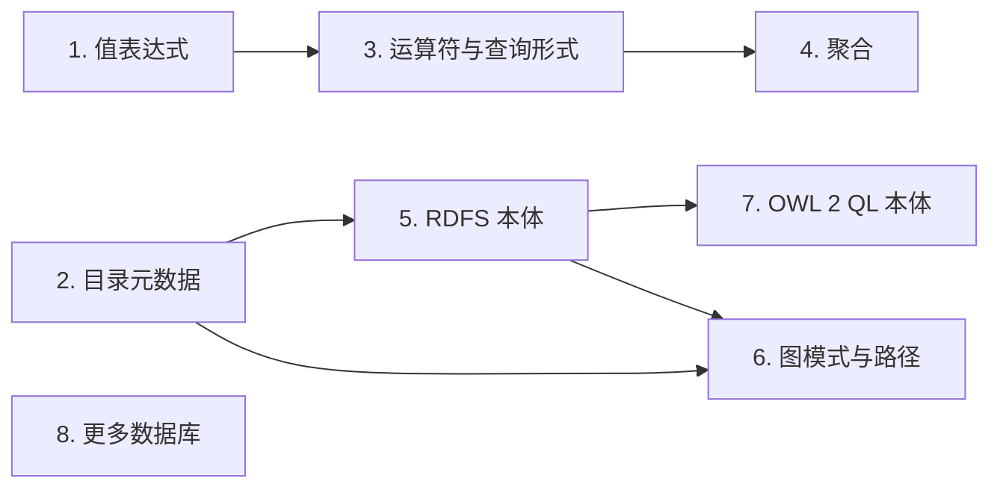

# sparql-v12n

[English](README.md) | [한국어](README.ko.md) | 简体中文

> 本文是 [README.md](README.md)（提交 ffa5953）的翻译。如有出入，以英文原文为准。

<p align="center"><b>用 Rust 编写的虚拟知识图谱引擎。它通过 R2RML 映射将 SPARQL 查询翻译为 SQL，并在源数据库上执行，无需复制数据。</b></p>

<p align="center">
  <picture>
    <source media="(prefers-color-scheme: dark)" srcset="docs/images/how-it-works-dark.svg">
    
  </picture>
</p>

- 每条 SPARQL 查询都会成为一条 SQL 查询，在存放数据的数据库上执行。数据不会被复制。
- 目前支持 PostgreSQL。其他数据库已列入[路线图](#路线图)。
- 哪些表和列对应哪些类和属性，由 R2RML 映射决定。映射之外的数据无法查询。
- 目前尚不支持本体推理。查询某个类时，只会得到映射中声明为该类的数据。参见[路线图](#路线图)。
- 单个可执行文件 `v12n` 同时提供命令行工具和 SPARQL 1.1 Protocol HTTP 端点。

> 状态：实验性。下文所列的支持范围已与 Ontop 及 W3C R2RML 测试用例对照测试。1.0 之前，命令、输出与 API 可能发生变化。

## 安装

从[发布](https://github.com/CharmingGroot/sparql-v12n/releases)页面下载与平台对应的压缩包，并将 `v12n` 放入 `PATH`。压缩包提供 Linux（x86_64 与 aarch64，静态二进制）、macOS（Apple silicon）和 Windows（x86_64）版本。

每个发布都附有 `SHA256SUMS` 文件和构建来源证明（attestation）。可用以下任一命令校验下载的文件（在 macOS 上，第一条命令请改用 `shasum -a 256 -c`）：

```sh
sha256sum --ignore-missing -c SHA256SUMS
gh attestation verify v12n-<version>-<target>.tar.gz -R CharmingGroot/sparql-v12n
```

使用 Rust 1.88 或更高版本从源码构建：

```sh
cargo install --locked --git https://github.com/CharmingGroot/sparql-v12n v12n-cli
```

`v12n --version` 输出版本以及构建所用的提交。

## 支持的 SPARQL

引擎回答针对一个 R2RML 映射和一个 PostgreSQL 数据库的 `SELECT` 查询。下表列出支持与拒绝的内容。被拒绝的查询以及表中未列出的形式会以错误结束（`v12n query` 退出码为 1，HTTP 端点返回 501），不会返回不同的答案。每项受支持的功能都在差分测试（`tests/diff`）中与 [Ontop](https://ontop-vkg.org/) 进行比较。

| 功能 | 说明 | 拒绝 |
|---|---|---|
| 基本图模式 | 常量谓词与 `rdf:type`；常量与共享变量按 RDF term 匹配，可跨越不同的列类型；一个三元组无论由多少行产生都只计一次 | 变量谓词、属性路径、`GRAPH`、`FROM` 与 `FROM NAMED` |
| `SELECT`、`SELECT *`、`DISTINCT` | 对解采用 bag 语义 | `REDUCED`、`SELECT` 中的表达式、`BIND`、子查询、`GROUP BY` 与聚合 |
| `OPTIONAL` | 嵌套与顺序排列、内部的 `FILTER`、未绑定变量 | 对仅由多个 `OPTIONAL` 部分绑定的变量使用 `SELECT DISTINCT`；`OPTIONAL` 内部包围一侧为空的 `UNION` 的 `FILTER` |
| `UNION` | 两侧的 bag 并集，在 `OPTIONAL` 内部同样适用；同一变量可对应不同形态的 term map | 在同一变量的自然数据类型列与另一种字面量形态之间去重 |
| `FILTER` | `=`、`!=`、`<`、`<=`、`>`、`>=`、`&&`、`\|\|`、`!`、`BOUND`、`sameTerm`、`isIRI`、`isBlank`、`isLiteral`、`STR`、`LANG`、`DATATYPE`、`REGEX`，遵循 SPARQL 的错误语义 | 其他函数、算术、`IN`、`EXISTS`；SPARQL 1.1 留给扩展处理的比较（`xsd:date` 的排序、带语言标签字面量上的 `!=`、带时区与不带时区的 dateTime 之间的比较）；`real` 列上的比较；含 `\d`、`\w`、`\p{..}` 与反向引用的 `REGEX` |
| `ORDER BY`、`LIMIT`、`OFFSET` | SPARQL 1.1 的顺序，在其未规定之处采用固定顺序 | 对 `SELECT DISTINCT` 未投影的变量使用 `ORDER BY` |
| 字面量 | RDF 1.1 的 term 相等：语言标签为小写，`xsd:string` 即简单字面量，XSD 1.1 规范词法形式 | 在 `FILTER` 中按值比较 `xsd:float` 与派生整数类型 |
| 其他形式 | 不进行 RDFS 推理：`rdf:type` 匹配映射中声明的类 | `ASK`、`CONSTRUCT`、`DESCRIBE`、`MINUS`、`VALUES`、`SERVICE` |

表中各项背后的规则见 [docs/semantics.zh-CN.md](docs/semantics.zh-CN.md)：[常量](docs/semantics.zh-CN.md#查询中的常量)、[连接](docs/semantics.zh-CN.md#跨列共享的变量)、[去重](docs/semantics.zh-CN.md#重复的三元组)、[`OPTIONAL`](docs/semantics.zh-CN.md#optional)、[`UNION`](docs/semantics.zh-CN.md#union)、[`FILTER`](docs/semantics.zh-CN.md#filter)、[排序](docs/semantics.zh-CN.md#order-bylimit-与-offset) 与[字面量](docs/semantics.zh-CN.md#字面量)。`tests/diff/README.md` 列出了与 Ontop 的已知差异，以及每个被拒绝的测试查询被拒绝的原因。

## 使用说明

| 命令 | 用途 |
|---|---|
| `v12n check` | 校验映射 |
| `v12n terms` | 列出映射公开的类和属性 |
| `v12n explain` | 不连接数据库，显示查询的 SQL |
| `v12n query` | 执行查询并输出结果 |
| `v12n serve` | 在 `/sparql` 提供 SPARQL 1.1 Protocol 端点 |

默认启用的限制为只读数据库会话、30 秒语句超时，以及最多 10000 个解。HTTP 端点还将查询大小限制为 64 KiB，并且最多同时处理 16 个请求。

各命令的输出格式与退出码，以及 HTTP 端点及其设置，见 [docs/usage.zh-CN.md](docs/usage.zh-CN.md)。

## 路线图

受支持的子集按以下顺序扩展。每一步是一个[里程碑](https://github.com/CharmingGroot/sparql-v12n/milestones)，箭头表示后一步建立在前一步之上。



1. 值表达式：`BIND`、`SELECT` 中的表达式、算术以及 SPARQL 1.1 函数
2. 目录元数据一次加载并可刷新，并利用 NOT NULL 与外键约束进行优化
3. `VALUES`、`MINUS`、`EXISTS`、子查询、`ASK`、`CONSTRUCT`、`DESCRIBE`，以及更多结果格式
4. `GROUP BY` 与聚合
5. 本体：RDFS 蕴涵
6. 变量谓词、命名图与属性路径
7. 本体：OWL 2 QL
8. PostgreSQL 以外的数据库

面向 AI 智能体的 MCP 服务器计划在上述步骤之后实现。

## 目录结构

| 路径 | 内容 |
|---|---|
| `crates/v12n-core` | SPARQL 解析、映射索引、展开、优化、SQL 渲染。不依赖数据库 |
| `crates/v12n-postgres` | 在 PostgreSQL 上执行，以及键元数据内省 |
| `crates/v12n-server` | SPARQL 1.1 Protocol HTTP 端点 |
| `crates/v12n-cli` | `v12n` 命令 |
| `crates/v12n-difftest` | 针对 Ontop 的差分测试，每个用例查询对应一个测试 |
| `docs` | 使用说明与查询语义参考文档，以及 README 中的图 |
| `examples/shop` | 示例数据库模式、数据、映射与查询 |
| `bench` | 在生成数据上与 Ontop 对比的基准测试及其结果 |
| `testenv` | 用于测试的本地 PostgreSQL 与 Ontop 参考端点 |
| `tests/diff` | 差分测试用例（`examples/` 也是用例），W3C R2RML 用例位于 `tests/diff/w3c` |
| `tests/w3c/rdb2rdf` | W3C RDB2RDF 测试文件，未经修改的子集（W3C Document License） |

## 参与贡献

关于如何提出修改、提交约定以及如何运行测试，请参阅 [CONTRIBUTING.md](CONTRIBUTING.md)。

## 许可证

Apache-2.0。参见 [LICENSE](LICENSE)。
