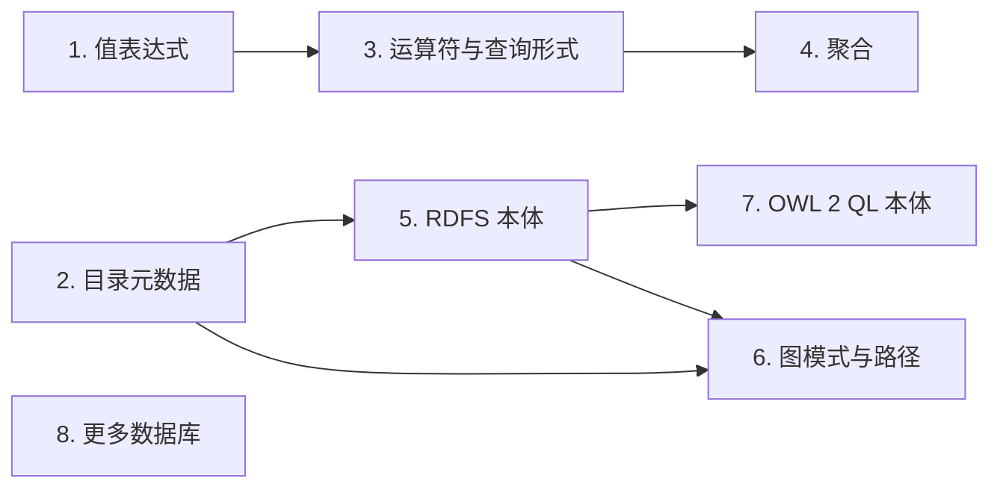

# sparql-v12n

[English](README.md) | [한국어](README.ko.md) | 简体中文

> 本文是 [README.md](README.md)（提交 102a38b）的翻译。如有出入，以英文原文为准。

通过 R2RML 映射以 SPARQL 查询 PostgreSQL，无需复制数据。

sparql-v12n 是一个用 Rust 编写的虚拟知识图谱引擎。它使用 R2RML 映射将 SPARQL 查询改写为 SQL，在源数据库上执行该 SQL，并返回 SPARQL 结果。映射同时精确规定了哪些表和列可以被查询。目前尚不支持本体推理：查询只匹配映射中声明的类和属性。

> 状态：实验性。MVP 范围的 SPARQL 子集已经实现，并已与 Ontop 及 W3C R2RML 测试进行对照；在 1.0 之前，API 与输出可能发生变化。

## 支持的 SPARQL

针对一个 R2RML 映射和一个 PostgreSQL 数据库的 `SELECT` 查询。下表中每项受支持的功能均通过差分测试（`tests/diff`）与 [Ontop](https://ontop-vkg.org/) 进行比较。被拒绝的形式以及未列出的任何内容，均作为不支持的功能报错（`v12n query` 退出码 1，HTTP 501），而不会给出不同的答案。

| 功能 | 说明 | 拒绝 |
|---|---|---|
| 基本图模式 | 常量谓词与 `rdf:type`；常量与共享变量按 RDF term 匹配，可跨越不同的列类型；一个三元组无论由多少行产生都只计一次 | 变量谓词、属性路径、`GRAPH`、`FROM` 与 `FROM NAMED` |
| `SELECT`、`SELECT *`、`DISTINCT` | 对解采用 bag 语义 | `REDUCED`、`SELECT` 中的表达式、`BIND`、子查询、`GROUP BY` 与聚合 |
| `OPTIONAL` | 嵌套与顺序排列、内部的 `FILTER`、未绑定变量 | 对仅由多个 `OPTIONAL` 部分绑定的变量使用 `SELECT DISTINCT`；`OPTIONAL` 内部包围一侧为空的 `UNION` 的 `FILTER` |
| `UNION` | 两侧的 bag 并集，在 `OPTIONAL` 内部同样适用；同一变量可对应不同形态的 term map | 在同一变量的自然数据类型列与另一种字面量形态之间去重 |
| `FILTER` | `=`、`!=`、`<`、`<=`、`>`、`>=`、`&&`、`\|\|`、`!`、`BOUND`、`sameTerm`、`isIRI`、`isBlank`、`isLiteral`、`STR`、`LANG`、`DATATYPE`、`REGEX`，遵循 SPARQL 的错误语义 | 其他函数、算术、`IN`、`EXISTS`；SPARQL 1.1 留给扩展处理的比较（`xsd:date` 的排序、带语言标签字面量上的 `!=`、带时区与不带时区的 dateTime 之间的比较）；`real` 列上的比较；含 `\d`、`\w`、`\p{..}` 与反向引用的 `REGEX` |
| `ORDER BY`、`LIMIT`、`OFFSET` | SPARQL 1.1 的顺序，在其未规定之处采用固定顺序 | 对 `SELECT DISTINCT` 未投影的变量使用 `ORDER BY` |
| 字面量 | RDF 1.1 的 term 相等：语言标签为小写，`xsd:string` 即简单字面量，XSD 1.1 规范词法形式 | 在 `FILTER` 中按值比较 `xsd:float` 与派生整数类型 |
| 其他形式 | 不进行 RDFS 推理：`rdf:type` 匹配映射中声明的类 | `ASK`、`CONSTRUCT`、`DESCRIBE`、`MINUS`、`VALUES`、`SERVICE` |

以下各节给出详细说明；`tests/diff/README.md` 列出了与 Ontop 的已知差异，以及每个被拒绝的测试查询被拒绝的原因。

## 接口

| 接口 | 用途 |
|---|---|
| `v12n` CLI | `check`、`terms`、`explain`、`query`、`serve` |
| HTTP | 位于 `/sparql` 的 SPARQL 1.1 Protocol 端点 |

## `v12n query`

`v12n query mapping.ttl query.rq --db postgresql://reader@localhost/shop` 输出 SPARQL 1.1 Query Results JSON；使用 `--format csv` 时输出 SPARQL 1.1 Query Results CSV（仅含词法形式，未绑定变量为空字段）；使用 `--format table` 时输出表格。查询可以来自文件、来自标准输入（使用 `-`），或通过 `--query '<SPARQL>'` 来自命令行。这些格式均无处标记部分结果，因此上限在结果之外报告，即写入 stderr 并体现在退出码中：

| 退出码 | 情形 |
|---|---|
| `0` | 成功，包括恰好为 `--row-limit` 行的结果 |
| `1` | 无效输入：参数、文件、查询语法、不支持的 SPARQL |
| `2` | 无效映射 |
| `3` | 数据库错误，或无法转换为 RDF term 的值 |
| `4` | 语句超时（`--timeout`）。在第一行之前发生时，与其他错误一样报告；在输出开始之后发生时，stdout 上的 JSON 保持未终止状态（CSV 没有结束标记） |
| `5` | 达到行数上限（`--row-limit`）：stdout 包含前 `--row-limit` 个解，构成完整的结果，stderr 中有一条警告 |

stderr 中的这一行会指明原因与上限，例如 `warning: result truncated at the row limit of 10000; more rows exist ...` 或 `error: statement timeout of 30s reached after 120 rows; ...`。

## 面向智能体的 CLI

该 CLI 既可手动使用，也可由 shell 工具驱动。它从不进行交互式提示；只要 stdout 不是终端就输出 JSON（`--format json` 强制输出 JSON）；仅在终端上使用颜色，且设置了 `NO_COLOR` 时从不使用颜色；所有命令均沿用上述退出码。从映射到答案的流程分为三步：

1. `v12n terms mapping.ttl` 列出映射公开的类与属性；其他任何内容都无法匹配。

   ```json
   {"prefixes":{"ex":"http://example.org/"},
    "classes":[{"iri":"http://example.org/Customer","prefixed_name":"ex:Customer","triples_maps":["<#CustomerMap>"]}, ...],
    "properties":[{"iri":"http://example.org/name","prefixed_name":"ex:name","triples_maps":["<#CustomerMap>"]}, ...]}
   ```

2. `v12n explain mapping.ttl --query '<SPARQL>'` 在没有数据库的情况下检查查询：语法错误或不支持的功能以退出码 1 退出；成功时输出 SQL、其绑定参数以及投影的变量。

   ```json
   {"sql":"SELECT DISTINCT t0.\"id\" AS \"customer\", ...","params":["VIP"],
    "variables":[{"name":"customer","term_type":"iri","columns":["customer"]}, ...]}
   ```

3. `v12n query mapping.ttl --query '<SPARQL>'` 执行查询（`--db` 或 `V12N_DATABASE_URL`），并输出 SPARQL 1.1 Query Results JSON；行数上限、语句超时与只读会话默认开启。

在产生任何输出之前发生的错误，会以一个 JSON 对象代替结果写到 stdout，因此调用方先检查退出码，然后在任何情况下都读取 stdout：

```json
{"ok":false,"error":{"kind":"query","message":"query syntax error: ...","exit_code":1}}
```

| `kind` | 退出码 | `details` |
|---|---|---|
| `input`、`query`、`unsupported`、`output`、`runtime` | 1 | 无法读取文件时为 `{"path": ...}` |
| `mapping` | 2 | |
| `database`、`data` | 3 | |
| `timeout` | 4 | `{"timeout_ms": ..., "rows": ...}` |

结果开始输出后，错误便无法再改变 stdout：错误以一行 `error: ...` 写入 stderr，使用 `--format csv` 或 `table` 时的所有错误也是如此；行数上限的 `warning: ...`（退出码 5）始终写入 stderr。`v12n <command> --help` 列出每个命令的 JSON 与 CSV 结构，并附有可在仓库根目录运行的示例。

## HTTP 端点

`v12n serve --config v12n.toml` 在 `/sparql` 提供 SPARQL 1.1 Protocol 服务（并在 `/healthz` 提供存活检查）：

- `GET /sparql?query=...`、使用 `application/x-www-form-urlencoded`（`query=...`）的 `POST`，或使用 `application/sparql-query` 并以查询作为请求体的 `POST`。
- 结果为 SPARQL 1.1 Query Results JSON（`application/sparql-results+json`），随行从 PostgreSQL 到达而以流式发送。请求其他格式时返回 `406`。
- `default-graph-uri` 与 `named-graph-uri` 返回 `400`：数据集即映射所定义的数据集。

| 状态码 | 情形 |
|---|---|
| `200` | 结果。设置了行数上限时，被截断的结果带有 `V12N-Truncated: <row limit>`，并恰好包含该数量的解（同样情况下 `v12n query` 以退出码 5 退出） |
| `400` | 查询语法错误、缺失或重复的 `query`、数据集参数、展开后 SQL 分支过多的查询 |
| `406` / `413` / `414` / `415` | 未提供该格式 / `POST` 中查询超过 `max_query_bytes` / `GET` 中查询超过该值 / 其他内容类型 |
| `501` | 尚不支持的 SPARQL 功能 |
| `503` | 第一行之前发生语句超时（`v12n query` 以退出码 4 退出），或达到 `max_concurrent_requests`（附带 `Retry-After`） |
| `500` | 数据库错误或其他内部错误 |

状态码在响应体之前发送，因此第一行之后发生的错误无法改变状态码：服务器中止响应（JSON 保持未终止状态）并记录该错误。结果是否被截断在第一行之前即可确定，因为 PostgreSQL 在发送行之前会先统计不超过上限的行数。

设置来自 TOML 文件（`--config`），环境变量会覆盖其中的值：

```toml
[server]
address = "127.0.0.1"
port = 7878

[database]
url = "postgresql://reader@localhost/shop"
password_env = "SHOP_DB_PASSWORD"   # optional: read the password from this variable

[mapping]
path = "mapping.ttl"                # relative to this file
base_iri = "http://data.example.com/"   # optional: for relative IRIs (see below)

[limits]
statement_timeout = "30s"           # 0 disables
row_limit = 10000                   # 0 disables
max_query_bytes = 65536
max_concurrent_requests = 16        # more are refused with 503, not queued
```

| 设置 | 环境变量 | 默认值 |
|---|---|---|
| `[server] address` | `V12N_ADDRESS` | `127.0.0.1` |
| `[server] port` | `V12N_PORT` | `7878` |
| `[database] url` | `V12N_DATABASE_URL` | 必填 |
| `[database] password_env` | （仅限文件） | 无 |
| `[mapping] path` | `V12N_MAPPING` | 必填 |
| `[mapping] base_iri` | `V12N_BASE_IRI` | 无：相对 IRI 视为数据错误 |
| `[limits] statement_timeout` | `V12N_STATEMENT_TIMEOUT` | `30s` |
| `[limits] row_limit` | `V12N_ROW_LIMIT` | `10000` |
| `[limits] max_query_bytes` | `V12N_MAX_QUERY_BYTES` | `65536` |
| `[limits] max_concurrent_requests` | `V12N_MAX_CONCURRENT_REQUESTS` | `16` |

`v12n query` 读取相同的 `V12N_DATABASE_URL`、`V12N_ROW_LIMIT`、`V12N_STATEMENT_TIMEOUT` 与 `V12N_BASE_IRI`，其优先级低于命令行选项；`v12n explain` 读取 `V12N_BASE_IRI`，`--base-iri` 也会覆盖 `serve` 的该项设置。`serve` 忽略其他 `V12N_*` 变量，并为每个变量记录一条警告，以便发现拼写错误的变量名。

请以只能读取的数据库用户连接；会话也会被设为只读事务。数据库 URL 和密码从不写入日志。请求日志（stderr，级别由 `RUST_LOG` 决定）包含生成的 SQL 与耗时，不包含结果值。TLS、认证与 CORS 由前置的反向代理负责。

## 列名

`rr:column`、模板与连接条件中的列名是 SQL 标识符（R2RML §5）。定界名称（`"\"Name\""`）按书写原样使用。常规名称按 PostgreSQL 解析未加引号名称的方式解析，即折叠为小写：`rr:column "StudentId"` 读取 `SELECT ... AS StudentId` 产生的列（`studentid`），而 `rr:column "Name"` 不匹配以 `"Name"` 创建的列。在执行使用此类名称的查询之前，引擎会准备一条探测语句，由 PostgreSQL 在其中解析该名称，然后在生成的 SQL 中为解析后的名称加引号。仅由小写字母、数字和 `_` 组成的名称无需探测。

## 相对 IRI

带有 `rr:termType rr:IRI` 的列或模板可能产生相对 IRI，例如 `Carlos` 或 `person/7`。R2RML 将其相对于提供给处理器的基础 IRI 进行解析（R2RML §4, §11.2），方式是简单的字符串拼接，而不是 RFC 3986 解析：以 `http://data.example.com/` 为基础 IRI 时，`Carlos` 变为 `<http://data.example.com/Carlos>`，`../x` 变为 `<http://data.example.com/../x>`。模板值会先进行百分号编码（`Bob/Charles` 得到 `Bob%2FCharles`）。

不存在默认的基础 IRI。未设置 `base_iri`（`--base-iri`、`V12N_BASE_IRI`）时，相对 IRI 属于 R2RML 数据错误，错误信息会指出该设置项，因此引擎从不为数据臆造 IRI。请将其设为数据所属的命名空间；它必须是绝对 IRI。

以 scheme（`http:`、`urn:`、...）开头的字符串视为绝对 IRI；片段不会使其成为相对 IRI。带有 scheme 但不是有效 IRI 的字符串属于数据错误，而 R2RML 会先尝试在其前面加上基础 IRI；两者仅在 `http://host:port/` 这类端口非数字的值上有所不同，这一处理使下文的 SQL 比较能够采用与结果相同的规则。

- 文本永远不会产生 scheme 的模板，例如 `{name}` 或 `person/{id}`，在加载映射时就在其前面加上基础 IRI。这样，`<http://data.example.com/person/7>` 这样的常量仍像以前一样在列上匹配（`id = $1`），并可使用该列的索引。
- 列中可能存放任一种形式，因此一个常量同时匹配两者：以 `http://data.example.com/a` 和 `a` 为参数的 `iri IN ($1, $2)`，这仍可使用该列上的索引。
- 在此类列上的连接，或在 scheme 取决于值的模板（如 `{scheme}:{rest}`）上的连接，会在 SQL 中比较生成的 IRI（`CASE WHEN iri ~ '^scheme:' THEN iri ELSE $base || iri END`），该列上的索引无法用于此比较。
- 去重按列值进行，因此相对值与其解析得到的绝对 IRI（`a` 与 `http://data.example.com/a`）仍计为两次；设置了基础 IRI 时，对此类列使用 `SELECT DISTINCT` 会作为不支持的功能被拒绝。

Ontop 5.5.0 会在每个不以绝对 IRI 开头的模板前加上 `http://example.com/base/`（W3C 测试用例的基础 IRI），且没有可更改它的设置；对于来自列的相对 IRI，Ontop 会失败。

## 列值的词法形式

每个非字符串值都以 XML Schema 1.1 Part 2（R2RML 所引用的版本）的规范形式写出，字面量与模板值均如此：`numeric` 12.50 与 3.00 分别变为 `"12.5"^^xsd:decimal` 与 `"3"^^xsd:decimal`（整数值的 decimal 不带小数点），`float8` 30 变为 `"3.0E1"^^xsd:double`，`boolean` 给出 `true`/`false`，`bytea` 给出大写十六进制。因此结果不依赖于列声明的标度。Ontop 则写出 PostgreSQL 的文本输出（`12.50`、`"30"^^xsd:double`）；差分测试将这些记录为已知差异（issue #25）。

SQL `=` 判定为不同的两个值可能是同一个 term：PostgreSQL 将 `time '24:00:00'` 与 `'00:00:00'` 区分开，而 XSD 1.1 将两者映射到同一个值，写作 `00:00:00`。两者都给出 `"00:00:00"^^xsd:time`；常量 `"00:00:00"^^xsd:time` 匹配两者，`"24:00:00"^^xsd:time` 不匹配任何值；连接、`DISTINCT`、`UNION` 与 `ORDER BY` 将两者视为同一个值（`col + interval '0'`）。`time` 列上的唯一键不会被用来证明查询没有重复。Ontop 按原样写出 `24:00:00`（issue #37）。

SQL `=` 判定为相等的两个值仍可能是不同的 term：`real` 与 `double precision` 列中的 `-0` 和 `0` 分别给出 `"-0.0E0"` 与 `"0.0E0"`；`char(n)` 值保留其填充（`'a'::char(3)` 给出 `"a  "`），而 `char(n)` 上的 `=` 会忽略填充。凡是引擎将此类列作为 term 比较之处（常量、连接、`sameTerm`，以及 `DISTINCT` 与 `UNION` 所做的去重），都会同时比较值的文本（针对零）或其长度（针对 `char(n)`），该比较与 `=` 并列，使该列上的索引仍能找到对应的行。

## 查询中的常量

三元组模式中的常量按 SPARQL 的要求作为 RDF term 匹配：词法形式与数据类型必须都相等。列值通过其 R2RML 自然映射参与比较（`integer` 列给出规范形式的 `xsd:integer`，`numeric` 给出规范的 `xsd:decimal`，以此类推）。因此，对于存放 7 的整数列：

| 常量 | 是否匹配 | 原因 |
|---|---|---|
| `7`、`<…/customer/7>` | 是 | |
| `"7"`、`"7"^^xsd:decimal`、`7.0` | 否 | 数据类型不同 |
| `"07"^^xsd:integer`、`<…/customer/007>`、`<…/customer/+7>` | 否 | 不是映射产生的规范形式 |
| `99999999999`、`<…/customer/99999999999>` | 否 | 超出该列的取值范围，因此没有任何行包含该值 |

常量作为绑定参数发送给 PostgreSQL，从不出现在 SQL 文本中。绑定之前，引擎会根据 PostgreSQL 从列推断出的参数类型检查每个常量：将常量按该类型读取，再用构建结果 term 的同一段代码将其格式化回去，只有 round trip 完全一致的常量才会发送，类型允许时以二进制形式发送。无法匹配的常量会使其所在的 `UNION` 分支为空，而不是让 PostgreSQL 因无法解析的输入而失败（在 `OPTIONAL` 内部时，仅该部分不匹配）；没有剩余分支时，查询不访问数据库。比较始终在列自身的类型上进行，因此可以使用其索引。对于没有自然数据类型的列类型（如 `interval`），结果中携带转换为文本的列值，常量也与同一文本进行比较（`col::text = $1`），这无法使用该列上的索引。

## 字面量

字面量在所有位置都作为 RDF 1.1 term 进行比较：三元组模式、连接、`sameTerm`、`FILTER` 中表示 RDFterm-equal 的 `=`、`DISTINCT` 以及结果。

- **语言标签**比较时不区分大小写（RDF 1.1 Concepts §3.3），因此引擎以小写形式保存语言标签：`rr:language "EN-us"` 给出 `"chat"@en-us`，常量 `"chat"@EN-US` 与之匹配；仅标签大小写不同的两个 term map 给出同一个 term。不是有效 BCP 47 语言标签的标签属于映射错误（R2RML §7.5），`rr:datatype rdf:langString`（仅用于带标签字符串的数据类型）同样属于映射错误。
- **`xsd:string`**：简单字面量即 `xsd:string` 字面量。`"x"` 与 `"x"^^xsd:string`、文本列、带有 `rr:datatype xsd:string` 的列以及字面量模板给出同一个 term，结果中写出时不带数据类型。`DATATYPE` 返回 `xsd:string`。
- **没有任何 term map 产生的数据类型**在三元组模式中永远不会匹配：整数列给出 `xsd:integer` term，因此 `"5"^^xsd:int` 与 `"5"^^xsd:decimal` 在该处不匹配任何值，自定义数据类型也不匹配。在按值比较数字的 `FILTER` 中，`xsd:float` 与派生整数类型会被拒绝（见 `FILTER`）。
- **`char(n)`** 值在 RDF term 中保留尾部的填充空格，与 SQL 标准及 W3C RDB2RDF 预期输出一致（D018：`"Venus          "`）。如需不带填充的值，请使用 `varchar` 或 `text`，或使用带 `rtrim()` 的 R2RML 视图。

跨数据类型的值比较，例如对整数列使用 `FILTER(?amount = 7.0)`，属于 `FILTER` 的范畴（见下文）。

## 跨列共享的变量

出现两次的变量即为连接，它同样比较 RDF term，而不是 SQL 值。在执行此类查询之前，引擎会（通过准备一条探测语句）向 PostgreSQL 查询相关列的类型，然后：

- 用 `=` 比较同类的列（整数、文本、日期等），从而使用索引；
- 对其他列对，在检查自然数据类型之后，通过在 SQL 中计算的自然词法形式进行比较（`int_col::text = text_col::text`）：存放 7 的 `integer` 列仅当文本列带有 `rr:datatype xsd:integer` 时才与其连接，且从不与 `numeric` 7.0 连接。`numeric` 值的规范形式以 `trim_scale(col)::text` 计算（PostgreSQL 13 或更高版本），并经测试确认与引擎自身的格式化结果一致；
- 当模板或 IRI 列只能作为字符串比较时，像 IRI 那样对模板值进行百分号编码（R2RML 的 IRI-safe 形式）；
- 当词法形式无法在 SQL 中计算时（例如 `float8` 或日期/时间模板值与文本列比较），将查询作为不支持的功能拒绝（退出码 1，HTTP 501），而不是在 PostgreSQL 中失败或返回错误的行。

## 取自不同类型列的变量

同一模式的各个 term map 可以从不同 SQL 类型的列读取同一个变量，例如一个 triples map 中的 `integer` 列与另一个 triples map 中的 `text` 列。`UNION` 要求每个结果列只有一种类型，因此对于涉及多个 term map 的查询，引擎还会向 PostgreSQL 查询所选列的类型，然后：

- 当类型可以合并且不改变任何值时（`int4` 与 `int8`，`text` 与 `varchar`），保留一个结果列；
- 将自然数据类型的字面量拆分为每种数据类型一个结果列；每个分支填充自己的列，其余列保持 `NULL`，因此整数 120 保持为 `"120"^^xsd:integer`，文本 `'120'` 保持为 `"120"`；
- 在两种类型可能给出同一个 term 的情况下，选取按连接中同样方式在 SQL 中计算的自然词法形式：模板值（基于 `integer` 键与基于 `text` 键的 `item/{id}` 都给出 `item/1`）、IRI 列、带 `rr:datatype` 或语言标签的字面量，以及来自 `text` 与 `uuid` 列的普通字面量。这样，来自两个 term map 的同一个三元组仍只计一次；
- 当该形式无法在 SQL 中计算时（`float8`、`real` 与 `double precision` 的组合、日期/时间、`char(n)`），将查询作为不支持的功能拒绝。

## 重复的三元组

RDF 图是三元组的集合，因此一个三元组无论由多少行产生都只计一次：无键表中的重复行、重复输出行的 R2RML 视图，或产生同一三元组的两个 term map。基本图模式对其全部变量的每个不同绑定给出一个解，之后 `SELECT` 才进行投影，因此 `SELECT ?city WHERE { ?p ex:city ?city }` 仍会为每个人返回一次城市。

生成的 SQL 对模式中每个变量的列使用 `DISTINCT`（或跨 term map 使用 `UNION`）去重；当其中部分列未被选取时，去重在子查询中进行。在执行通过单一 term map 组合（在 `UNION` 的某一侧中）读取表（而非视图）的查询之前，引擎会从系统目录读取这些表的唯一键；当每个表在解所确定的列中都有一个键时，任意两行都不可能给出相同的解，SQL 便保留所有行而不使用 `DISTINCT`。否则 PostgreSQL 必须去重，这需要对行进行哈希或排序，并且除非有索引按顺序提供这些行，否则在返回第一行之前要读取全部行。`v12n explain` 没有数据库，因此始终显示 `DISTINCT`。

重复按列值比较，因此模板渲染为相同字符串的两个不同值（`{a}-{b}` 分别取 `x-`、`y` 与 `x`、`-y`）仍计为两次。未被选取的变量按其列的类型与文本输出比较，因此在 SQL 无法计算其词法形式的情况下，或者在类型合并（`varchar` 与 `text`）或文本不同（`numeric` 1.0 与 1.00）时，来自不同类型列的相等 term 也计为两次。

## OPTIONAL

`OPTIONAL` 遵循 SPARQL 代数的 LeftJoin：左侧的每个解都会保留，并在存在兼容解时，由可选部分的每个兼容解进行扩展。SQL 中每个可选部分对应一个 `LEFT JOIN`：

- 该部分的表先彼此连接（有多个时置于括号内），`ON` 子句同时包含该部分自身的条件与到左侧的关联。嵌套的 `OPTIONAL` 是外层 `LEFT JOIN` 内部的 `LEFT JOIN`，写在 `OPTIONAL` 之后的模式在其之后连接。
- 共享变量与连接中一样按 RDF term 比较，因此带类型的列与模板分解的处理方式相同，两侧均为普通列时会使用索引。
- 未绑定变量在 SQL 中为 `NULL`，在 JSON 绑定中省略。当共享变量可能在某一侧未绑定时（仅由更早的 `OPTIONAL` 绑定，或仅由嵌套在该部分中的 `OPTIONAL` 绑定），它与任何值兼容：条件为 `(left IS NULL OR left = right)`，该列上的索引无法用于此条件。
- 每个部分先按代数的求值方式单独翻译，因此将嵌套部分与外层左侧关联的条件在外层部分的 `ON` 子句中检查，从不在嵌套部分内部检查。
- 仅由 `OPTIONAL` 部分绑定的变量从每个这样的部分获得列，其值为该行中第一个已绑定的值。可选部分中的常量 term 附带一个标志列，表示该部分是否匹配。
- 与任何基本图模式一样，重复的三元组在每个部分内只计一次。

- 当一个可选部分可由多种 triples map 组合匹配，或可由其内部 `UNION` 的多个侧匹配时，它是这些选择的并集，且 LeftJoin(L, R1 ∪ R2) 为 Join(L, R1) ∪ Join(L, R2) ∪ Diff(L, R1 ∪ R2)。SQL 分支随之拆分：每个选择对应一个分支，该分支带有其 `LEFT JOIN`，并以 `WHERE` 要求其部分已匹配（PostgreSQL 会将其转换为内连接）；另有一个分支带有所有选择的 `LEFT JOIN`，并以 `WHERE` 要求均未匹配（反连接），从而保留没有任何解可扩展的左侧解。每个部分保留其 `ON` 子句，因此与单个部分的情况一样，由兼容性和 `OPTIONAL` 内的 `FILTER` 决定其是否匹配。在外层部分内部，这些拆分成为外层部分的选择。一侧为空的 `UNION` 通过该空侧原样扩展每个左侧解。

尚不支持、作为不支持的功能拒绝的情形：对仅由多个 `OPTIONAL` 部分绑定的变量使用 `SELECT DISTINCT`；`OPTIONAL` 内部包围一侧为空的 `UNION` 的 `FILTER`。

## UNION

`{ A } UNION { B }` 以 bag 形式包含两侧的解：两侧都给出的解计为两次，在 `SELECT DISTINCT` 下计为一次。仅由一侧绑定的变量在另一侧的解中未绑定。

- 连接、`FILTER` 与 `OPTIONAL` 对位于其左侧的并集满足分配律，因此引擎单独展开每个 arm（即对每个 `UNION` 各选一侧所得的组合），再以 `UNION ALL` 合并各 arm。每个 arm 与任何其他模式一样翻译：重复的三元组在其内部只计一次（使用 `DISTINCT`，或跨其 term map 使用 `UNION`，或在键能证明不存在重复时不做处理，此检查现按 arm 进行），各 arm 之间从不相互比较。arm 的数量乘以每个 arm 的 term map 组合数，上限为 64，与单个模式的分支上限相同。
- 一侧中的 `FILTER` 仅作用于该侧的解；包围该并集的组中的 `FILTER` 作用于两侧的解，此时另一侧的变量未绑定。
- `OPTIONAL` 内部的 `UNION` 不对左连接满足分配律；其各侧是可选部分的选择（见 `OPTIONAL`），每侧的解保留在各自的 arm 中。

在不同的侧或不同的 term map 中，一个变量可以从不同形态的 term map 取值：一处为模板，另一处为列或另一个模板；常量、IRI 与字面量；或不同数据类型或语言标签的字面量。结果根据该行所属分支的 term map 重建每个值：

- 永远不可能给出相同 term 的形态获得各自的结果列，由每个分支填充自己的列：`http://example.org/customer/{id}` 与 `http://example.org/wholesale/{code}`（固定文本不同，或一方的文本在另一方的值中总会被 IRI-safe 编码转义），IRI 与字面量，两个不同的常量，或两个语言标签。基于这些列的去重保持精确。
- 可能给出同一 term 且需要比较重复（在一个 arm 内或在 `SELECT DISTINCT` 下）的形态，共享一个包含该 term 字符串的结果列，该字符串与连接中一样在 SQL 中计算（IRI-safe 模板、相对于基础 IRI 解析的 IRI、自然词法形式），因此来自模板和来自 IRI 列的同一三元组只计一次。此类列无法使用索引，并且要为每一行计算该字符串。当 SQL 无法计算词法形式时（与连接相同），以及对于其中一种形态是自然数据类型列的字面量（其数据类型取决于 SQL 类型），作为不支持的功能拒绝。

## FILTER

`FILTER` 遵循 SPARQL 的求值规则，包括错误的处理。错误既不是真也不是假：`error || true` 为真，`error && false` 为假，`!error` 仍为错误。SQL 以 `NULL` 表示错误，SQL 的 `AND`、`OR` 与 `NOT` 对其处理方式相同，而 `WHERE` 仅保留过滤条件为真的行。SPARQL 判定为错误的比较在 SQL 中为 `NULL`，从不为 `false`，因此 `FILTER(!(?x = 5))` 会丢弃 `?x` 未绑定或为字符串的行。

过滤条件的作用范围：

- 组中的 `FILTER` 作用于整个组，无论写在何处，且只能看到该组的变量：在 `{ ?s ex:name ?n { ?s ex:qty ?q FILTER(?n = "x") } }` 中，该过滤条件为错误，因为 `?n` 在嵌套组内未绑定。
- `OPTIONAL` 内的 `FILTER` 进入该部分 `LEFT JOIN` 的 `ON` 子句：它决定该部分是否匹配，从不决定保留左侧的哪些行，并且可以看到左侧的变量。当其为错误时，该部分不匹配，与 SQL 的 `LEFT JOIN` 相同。位于 `OPTIONAL` 之后的 `FILTER` 处于 `WHERE` 中，会丢弃行。
- 除 `BOUND` 外，未绑定变量对所有函数都是错误。仅由 `OPTIONAL` 部分绑定的变量从已匹配的部分读取（`CASE WHEN part matched THEN ... END`）。

比较遵循 SPARQL 的运算符映射：

| 操作数 | `=`、`!=`、`<`、`<=`、`>`、`>=` |
|---|---|
| 数字（`xsd:integer`、`xsd:decimal`、`xsd:double`） | 按值比较，采用 XPath 类型提升：`7.0` 等于整数 7，`-0` 等于 `0`，NaN 不等于任何值。 |
| 字符串（简单字面量、`xsd:string`） | 按码位比较（`COLLATE "C"`，要求数据库使用 UTF-8）。 |
| `xsd:boolean` | `false` < `true`。 |
| `xsd:dateTime` | 两者都带时区或都不带时区时按时刻比较；带时区的值与不带时区的值之间的比较依赖隐式时区，因此被拒绝。 |
| IRI、空白节点以及其他类型的字面量 | 仅支持 `=` 与 `!=`，作为 RDF term 比较（RDFterm-equal）；`<` 及其他运算符为错误。两个不同的字面量之间的比较为错误。 |

与列比较的常量，在能给出相同结果的情况下转换为列的类型（`?qty > 5` 即 `qty > $1::int8`，`?qty = 7.0` 即 `qty = $1::int8`），因此可以使用该列上的索引。否则，将列转换为 XPath 类型提升后的类型（`?qty < 5.5` 将整数列转换为 `numeric`，`?qty < 5.5e0` 转换为 `float8`），该列上的索引无法用于此比较。

支持 `sameTerm`、`BOUND`、`isIRI`、`isBlank`、`isLiteral`、`STR`、`LANG` 与 `DATATYPE`；在需要布尔值的位置，term 代表其有效布尔值（空字符串与零为假）。列的 `STR` 与 `DATATYPE` 在其词法形式或自然数据类型可在 SQL 中确定时可用，与连接相同；`date` 与 `timestamp` 的无穷值是普通字面量，因此其 `DATATYPE` 为 `xsd:string`。

`REGEX` 将 XPath 正则表达式翻译为匹配结果相同的 PostgreSQL 模式，并在 `COLLATE "C"` 下以 `~` 应用：

| XPath | PostgreSQL 模式 |
|---|---|
| `.`（不带 `s`） | 除换行符与回车符之外的任意字符，`[^\u000A\u000D]` |
| `^`、`$` | 字符串的开头与结尾，与 PostgreSQL 的默认行为相同 |
| 带 `m` 的 `^`、`$` | 位于行边界，但不在末尾的换行符之后（XPath 3.1），使用环视实现 |
| `i` | 每个字符展开为其大小写变体（`lower-case` 或 `upper-case` 相等者），因此无论数据库的区域设置如何，`i` 也匹配 `ı`，`k` 也匹配开尔文符号 |
| `\s` | 恰好为空格、制表符、换行符、回车符 |
| `x` | 移除字符类之外的空白 |
| 其他字符 | 除 ASCII 字母或数字外，写作 `\uXXXX` 转义 |

作为不支持的功能拒绝：`\d`、`\w`、`\i`、`\c`、`\p{..}` 及其补集（PostgreSQL 仅通过区域设置提供的 Unicode 类）、反向引用、字符类减法、大于 255 的计数、字符类内部的 `\S`、`q` 标志，以及非常量的模式或标志。无效的模式或标志为错误，与 XPath 相同。

以下情形作为不支持的功能拒绝，而不是给出与扩展了 SPARQL 的引擎不同的答案：

- 对上表之外的同一数据类型的两个字面量（如 `xsd:date`）进行排序或比较，以及对两个带语言标签的字面量进行比较（否定之外的 `=` 除外）；
- `real` 列上的比较；`rr:datatype` 为该列自然数据类型以外的数值、布尔或 dateTime 数据类型的列的值；`xsd:float` 与派生整数类型；超出公元 1 至 9999 年范围或精度细于微秒的 dateTime 常量；
- 其他函数、算术、`IN`、`EXISTS`，以及以 term（变量、常量，以及它们的 `STR`、`LANG` 或 `DATATYPE`）以外的表达式作为操作数；
- 在编码不是 UTF-8 的数据库中进行字符串排序和 `REGEX`。

## ORDER BY、LIMIT 与 OFFSET

解修饰符按代数的顺序应用：`ORDER BY`，然后是投影、`DISTINCT`、`OFFSET` 与 `LIMIT`（SPARQL 1.1 §18.2.5），全部在 SQL 中完成。

`ORDER BY` 接受变量以及 `FILTER` 支持的表达式，每项为 `ASC`（默认）或 `DESC`。解按 SPARQL 的顺序排列（§15.1）：

1. 无值（未绑定变量，或为错误的表达式）
2. 空白节点
3. IRI，按码位
4. 字面量：当 `<` 运算符能对其中两个排序时，与 `FILTER` 一样按 `<` 排序：数字按值并采用 XPath 类型提升，字符串按码位，`false` 在 `true` 之前，dateTime 按时刻。

在 SPARQL 未规定顺序之处，引擎采用自身的固定顺序，该顺序在 Discussion #63 中确定：

- 不同种类的字面量：数字、布尔值、dateTime、字符串、带语言标签的字面量，然后是其他数据类型；
- 带语言标签的字面量先按词法形式，再按语言标签；其他数据类型先按数据类型 IRI，然后对 `date` 与 `time` 列按值，其他情况按词法形式；
- NaN 排在所有数字之后，`numeric` 的 NaN 与无穷值位于 PostgreSQL 放置它们的位置；数据类型不同的相等数字（`1` 与 `1.0`）之间没有特定顺序；
- `date` 与 `timestamp` 列的无穷值是普通字面量（`"infinity"`），在字符串之间排序。

`DESC` 将上述全部顺序反转，因此未绑定值排在最后。每个比较项变为若干个 SQL 排序键（term 的种类，然后是每个种类对应的值），因此不同 SQL 类型的值以及不同 `UNION` 分支的值可以一起排序。当单个普通 `SELECT` 读取某个比较项的列且该列中不可能有其他内容时（非可选的数值、布尔或 dateTime 列），SQL 直接按该列排序，该列上的索引可以按顺序提供行；字符串与 IRI 在 `COLLATE "C"` 下排序，其他排序规则的索引无法用于此排序。排序键作为额外的列选取，从不属于结果；引擎包裹在另一查询外层的每个查询（行数统计、将列转换为文本）都会再次按这些键排序，因为 SQL 不会经由子查询保持顺序：最外层查询决定行到达的顺序。`v12n explain` 没有列类型，因此显示的每一列都按字符串排序。

`LIMIT` 与 `OFFSET` 是 SQL 的绑定参数。查询的 `LIMIT` 不超过行数上限时，最多保留该数量的解，因此结果从不被报告为截断；超过行数上限时，行数上限仍然适用。

作为不支持的功能拒绝：对 `SELECT DISTINCT` 未投影的变量使用 `ORDER BY`（一个投影后的解可能代表多个被排在不同位置的解）；作用于带时区与不带时区的值、作用于 `real` 列，或作用于编码不是 UTF-8 的数据库中的字符串的比较项；以及与 `FILTER` 中一样，其他函数、算术和 SQL 无法计算的字符串形式。

## 路线图

受支持的子集按以下顺序扩展。每一步是一个[里程碑](https://github.com/CharmingGroot/sparql-v12n/milestones)，箭头表示后一步建立在前一步之上。



1. 值表达式：`BIND`、`SELECT` 中的表达式、算术以及 SPARQL 1.1 函数
2. 目录元数据一次加载并可刷新，并利用 NOT NULL 与外键约束进行优化
3. `VALUES`、`MINUS`、`EXISTS`、子查询、`ASK`、`CONSTRUCT`、`DESCRIBE`，以及更多结果格式
4. `GROUP BY` 与聚合
5. 本体：RDFS 蕴涵
6. 变量谓词、命名图与属性路径
7. 本体：OWL 2 QL
8. PostgreSQL 以外的数据库

面向 AI 智能体的 MCP 服务器计划在上述步骤之后实现。

## 目录结构

| 路径 | 内容 |
|---|---|
| `crates/v12n-core` | SPARQL 解析、映射索引、展开、优化、SQL 渲染。不依赖数据库 |
| `crates/v12n-postgres` | 在 PostgreSQL 上执行，以及键元数据内省 |
| `crates/v12n-server` | SPARQL 1.1 Protocol HTTP 端点 |
| `crates/v12n-cli` | `v12n` 命令 |
| `crates/v12n-difftest` | 针对 Ontop 的差分测试，每个用例查询对应一个测试 |
| `examples/shop` | 示例数据库模式、数据、映射与查询 |
| `bench` | 在生成数据上与 Ontop 对比的基准测试及其结果 |
| `testenv` | 用于测试的本地 PostgreSQL 与 Ontop 参考端点 |
| `tests/diff` | 差分测试用例（`examples/` 也是用例），W3C R2RML 用例位于 `tests/diff/w3c` |
| `tests/w3c/rdb2rdf` | W3C RDB2RDF 测试文件，未经修改的子集（W3C Document License） |

## 参与贡献

关于如何提出修改、提交约定以及如何运行测试，请参阅 [CONTRIBUTING.md](CONTRIBUTING.md)。

## 许可证

Apache-2.0。参见 [LICENSE](LICENSE)。
