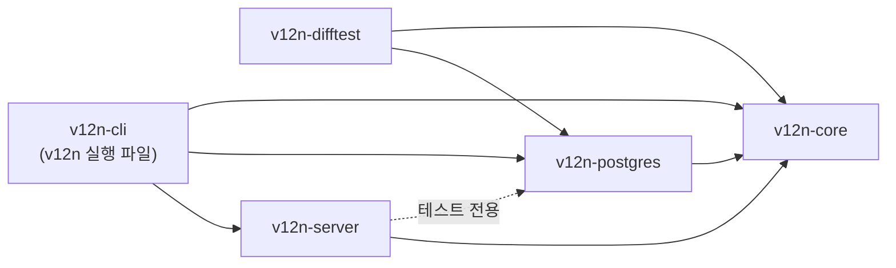
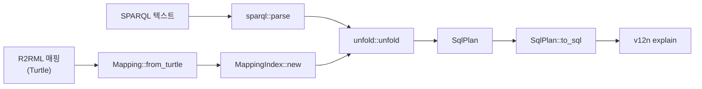
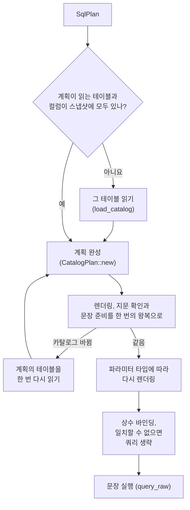
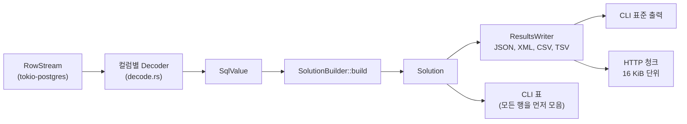
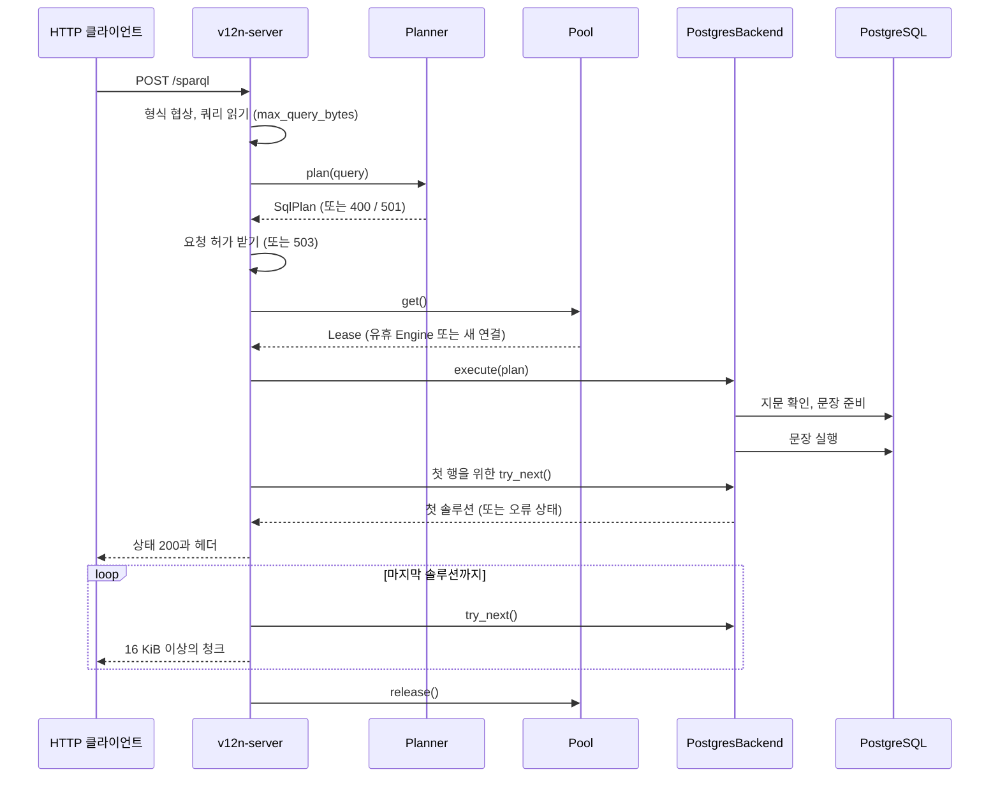

# 아키텍처

[English](architecture.md) | 한국어 | [简体中文](architecture.zh-CN.md)

> 이 문서는 [architecture.md](architecture.md)(#186에서 추가)의 번역이다. 내용이 다르면 영어 원문을 따른다.

이 문서는 sparql-v12n의 크레이트가 서로 어떻게 의존하는지, 그리고 SPARQL 쿼리가 결과가 되기까지 거치는 단계를 설명한다.
다루는 단계는 DB 없이 하는 계획 수립, DB 카탈로그를 읽는 단계, 실행, 행을 결과로 바꾸는 과정이다.
이 문서는 `main`의 코드를 설명하며, 마지막 절에서 계획된 변경과 구분한다.
쿼리 의미 규칙은 [semantics.ko.md](semantics.ko.md)에, 명령과 설정은 [usage.ko.md](usage.ko.md)에 있다.

## 크레이트

화살표는 Cargo 의존 관계다.
점선 화살표는 `dev-dependency`다. 서버의 테스트는 PostgreSQL에서 실행되지만 서버 자체는 DB에 대해 제네릭이다.

| 크레이트 | 역할 | 진입점 |
|---|---|---|
| `v12n-core` | 매핑 모델과 인덱스, SPARQL 파싱, `SqlPlan` 생성(unfold), 계획 재작성, SQL 렌더링, 행을 솔루션으로 변환, 결과 형식. DB 드라이버와 비동기 런타임에 의존하지 않는다 | [`Planner`](../crates/v12n-core/src/planner.rs), [`Engine`](../crates/v12n-core/src/engine.rs), [`backend`](../crates/v12n-core/src/backend.rs) |
| `v12n-postgres` | PostgreSQL 어댑터. 연결과 TLS, 카탈로그 조회, 문장 준비, 파라미터 바인딩, 값 디코딩 | [`PostgresConnector`](../crates/v12n-postgres/src/connector.rs), [`PostgresBackend`](../crates/v12n-postgres/src/lib.rs) |
| `v12n-server` | SPARQL 1.1 Protocol 엔드포인트. 요청 해석, 콘텐츠 협상, 제한, 세션 풀, 청크 응답 | [`serve`](../crates/v12n-server/src/lib.rs), [`protocol`](../crates/v12n-server/src/protocol.rs), [`pool`](../crates/v12n-server/src/pool.rs) |
| `v12n-cli` | `v12n` 명령. 인자 해석, 출력 형식, 종료 코드 | [`main.rs`](../crates/v12n-cli/src/main.rs) |
| `v12n-difftest` | 차등 테스트. 각 사례의 쿼리를 라이브러리와 Ontop에서 각각 실행하고 결과를 비교한다 | [`lib.rs`](../crates/v12n-difftest/src/lib.rs), [`engine.rs`](../crates/v12n-difftest/src/engine.rs) |

## 포트

`v12n-core`는 프런트엔드와 DB 사이의 경계를 trait로 정의하고, 나머지 크레이트는 그 양쪽의 어댑터다.

| 포트 | 종류 | 역할 | 구현 |
|---|---|---|---|
| `Planner` | 주도(driving) | 매핑과 인덱스를 가지고 쿼리 계획을 세운다. DB가 필요 없다 | `v12n-core` |
| `Engine<B>` | 주도(driving) | 공유하는 `Planner`·`Catalog`와 DB 세션 `B` 하나를 묶어 계획을 완성하고 렌더링하고 실행한다 | `v12n-core` |
| `Connector` | 피동(driven) | 프런트엔드가 넘기는 쿼리 제한으로 세션을 연다 | `PostgresConnector` |
| `Backend` | 피동(driven) | 세션 하나. SQL 방언, `load_catalog`, `CatalogPlan`의 `execute`, `is_closed` | `PostgresBackend` |
| `SolutionStream` | 피동(driven) | 쿼리 하나의 솔루션을 하나씩 읽고, 결과가 잘렸는지 알린다 | `v12n_postgres::Solutions` |
| `BackendError` | 피동(driven) | 오류를 `Config`, `Database`, `Timeout`, `StaleCatalog`, `Core`로 분류한다. 프런트엔드는 이 분류로 종료 코드와 HTTP 상태를 정한다 | `v12n_postgres::Error` |
| `Dialect` | 피동(driven) | DB마다 다른 SQL 문법 | `PostgresDialect` |

trait 메서드는 `impl Future + Send`를 반환하므로 프런트엔드는 `Connector`에 대해 제네릭이고 모든 호출은 정적으로 디스패치된다.
`v12n-server`는 DB 타입을 이름으로 쓰지 않는다.
`v12n-cli`에서는 `main.rs`의 `connector` 함수만 `PostgresConnector`를 쓴다.

## DB 없이 하는 계획 수립

1. [`Mapping::from_turtle`](../crates/v12n-core/src/mapping.rs)이 R2RML 매핑을 파싱한다.
   `with_base_iri`는 상대 IRI를 해석할 기준 IRI를 정한다.
2. [`Planner::new`](../crates/v12n-core/src/planner.rs)가 `MappingIndex`를 만든다.
   이 인덱스는 클래스나 속성을 만들 수 있는 triples map을 찾는다. `Planner` 하나에 한 번 만든다.
3. [`Planner::plan`](../crates/v12n-core/src/planner.rs)은 [`sparql::parse`](../crates/v12n-core/src/sparql.rs)와 [`unfold::unfold`](../crates/v12n-core/src/unfold.rs)를 차례로 호출한다.
   `sparql::parse`는 텍스트를 SPARQL 대수로 바꾸고 지원하지 않는 기능을 거절한다. `unfold::unfold`는 `SqlPlan`을 만든다.
   트리플 패턴은 일치하는 triples map의 논리 테이블 스캔이 되고, 공유 변수는 조인 조건이 되며, `OPTIONAL`은 `LEFT JOIN`이 된다.
   후보 triples map의 조합 하나가 `UNION ALL`의 SQL 브랜치 하나가 된다. 브랜치가 `MAX_BRANCHES`(64)개를 넘으면 거절한다.
4. [`SqlPlan::to_sql`](../crates/v12n-core/src/sql/renderer.rs)은 DB 정보 없이 PostgreSQL용 SQL을 렌더링한다.
   `v12n explain`이 출력하는 SQL이 이것이다. 중복 제거가 필요 없다는 것은 테이블 키로만 알 수 있으므로, 이 SQL은 중복을 제거하는 단계를 모두 유지한다.

이 단계의 오류는 쿼리나 매핑의 문제이며, `QuerySyntax`, `UnsupportedFeature`, `TooManyBranches`가 있다.

## DB를 읽는 단계

실제로 실행되는 SQL은 `v12n explain`의 SQL과 다르다.
키, 컬럼 타입, 해석한 컬럼 이름은 백엔드가 `load_catalog`로 읽는 카탈로그 스냅샷([`CatalogSnapshot`](../crates/v12n-core/src/catalog.rs))에서 가져오고, 쿼리마다 DB가 아직 스냅샷과 같은지 확인한다([Discussion #187](https://github.com/CharmingGroot/sparql-v12n/discussions/187)).

- **스냅샷.** 논리 테이블마다 존재 여부, 매핑이 읽는 컬럼(해석한 이름, 타입, `NOT NULL`), 모든 행에서 성립하는 유일 키(유효하고, 지연 가능하지 않고, 부분 인덱스가 아니고, 일반 컬럼에 걸려 있고, 상속 자식 테이블이 없는 테이블의 키), 검증된 외래 키, 지문을 담는다.
  지문은 이 정보를 읽어 온 카탈로그 행을 PostgreSQL이 SHA-256으로 계산한 해시다.
  `v12n serve`는 시작할 때 매핑의 모든 테이블을 읽고, `v12n query`는 계획이 읽는 테이블만 읽는다.
- **계획 완성.** [`CatalogPlan::new`](../crates/v12n-core/src/catalog/plan.rs)는 `v12n-core`에서 DB 없이 실행된다.
  PostgreSQL이 소문자로 바꾸는 컬럼 이름을 해석한다.
  term 컬럼마다 붙는 `IS NOT NULL`(R2RML §11에 따라 `NULL`에서는 항을 만들지 않음)은 테이블의 `NOT NULL` 제약으로 항상 참이면 뺀다. 뷰의 컬럼과 `LEFT JOIN` 때문에 `NULL`이 될 수 있는 컬럼에는 남긴다.
  키가 있으면 한 브랜치가 같은 행을 두 번 스캔하는지 알 수 있어 스캔을 합치고, 결과에 중복이 생길 수 없는지 알 수 있어 `DISTINCT`나 중복을 제거하는 `UNION`을 생략한다.
  `NOT NULL` 컬럼에 걸린 검증된 외래 키가 같은 컬럼 타입의 유일 키를 참조하면 각 행에 참조되는 행이 정확히 하나 있다. 쿼리가 그 키로 조인하고 키 컬럼만 읽는 참조 테이블 스캔은 없애고, 그 항은 참조하는 컬럼으로 만든다.
  컬럼 타입에 따라 `UNION` 브랜치를 맞추는 방법과 값을 RDF 항으로 비교하는 방법이 정해진다. 이 타입에서 SQL이 SPARQL과 같은 답을 낼 수 없는 비교는 `UnsupportedFeature`로 실패한다.
  스냅샷에 없다고 나온 테이블이나 컬럼은 `Catalog`로 실패한다.
- **확인.** [`PostgresBackend::run`](../crates/v12n-postgres/src/lib.rs)은 계획이 읽는 테이블의 지문 쿼리와 문장 준비를 파이프라인 왕복 한 번으로 보낸다.
  `rr:sqlQuery`를 읽는 계획은 같은 왕복에서 그 probe도 파싱해 컬럼 이름과 타입을 스냅샷과 비교한다.
  하나라도 다르면 문장을 실행하지 않고, 엔진이 그 테이블을 다시 읽어 계획을 한 번 더 세운다. 두 번째에도 다르면 다시 시도할 수 있는 오류(HTTP 503)로 실패한다.
  `v12n query`처럼 방금 테이블을 읽은 쿼리는 다시 확인하지 않는다.
- **파라미터.** 쿼리의 상수는 모두 바인딩 파라미터다.
  PostgreSQL이 추론한 파라미터 타입에 따라 SQL이 바뀔 수 있다. 예를 들어 디코더가 없는 타입은 텍스트 출력과 비교해야 한다. 이때 문장을 다시 렌더링하고 다시 준비한다.
  연결은 처음 렌더링한 SQL을 키로 다시 렌더링한 SQL을 기억해 두었다가 다음에 첫 문장과 함께 준비하고, 타입이 요구하는 문장과 정확히 같을 때만 쓴다.
- **행 제한.** 행 제한으로 결과가 잘릴 수 있으면, 문장은 제한보다 한 행 더 읽고 `count(*) OVER ()`를 추가 컬럼으로 가진다.
  그래서 첫 행에서 결과가 잘렸는지 알 수 있다.

확인과 실행은 서로 다른 왕복이므로, 그 사이에 커밋된 스키마 변경은 해당 쿼리에 반영되지 않는다.

## 행에서 결과까지

1. [`Solutions::try_next`](../crates/v12n-postgres/src/lib.rs)가 연결에서 행 하나를 읽는다.
   문장에 행 수 컬럼이 있으면 첫 행에서 그 값을 읽어 결과가 잘렸는지 기록한다.
2. 컬럼의 PostgreSQL 타입으로 고른 [`Decoder`](../crates/v12n-postgres/src/decode.rs)가 바이너리 값을 `SqlValue`로 읽는다.
   디코더가 없는 타입의 컬럼은 SQL에서 텍스트로 변환한다.
3. [`SolutionBuilder`](../crates/v12n-core/src/solution.rs)가 값을 RDF 항으로 바꾼다.
   SQL 값의 자연 RDF 리터럴(R2RML §10.2)과 투영된 term map의 항 생성(R2RML §11)을 따른다.
4. [`ResultsWriter`](../crates/v12n-core/src/results.rs)가 솔루션을 하나씩 SPARQL 1.1 Query Results JSON, XML, CSV, TSV 형식으로 쓴다.

첫 행 이후의 처리는 두 프런트엔드가 다르다.

- `v12n query`는 첫 행을 받을 때까지 아무것도 출력하지 않는다. 그래서 계획 수립이나 실행 초기의 오류를 선택한 출력 형식과 종료 코드로 알릴 수 있다.
  이후 JSON, XML, CSV, TSV는 솔루션 하나씩 표준 출력에 쓴다.
  `table` 형식은 컬럼 너비를 정하려면 모든 행이 필요하므로 행을 먼저 모두 모은다. 모으는 행 수의 상한은 행 제한이다.
- HTTP 엔드포인트도 첫 행을 기다리므로 그때까지의 오류는 상태 코드로 응답할 수 있다.
  그 뒤 상태 줄과 헤더를 보내며, 행 제한에서 결과가 잘리면 `v12n-truncated` 헤더를 붙인다.
  본문은 16 KiB 이상의 청크로 쓴다.
  상태 줄 이후의 오류는 마지막 청크 없이 응답을 중단하고, JSON과 XML은 닫히지 않은 채 남는다. 그래서 일부만 받은 본문이 완전한 결과로 보이지 않는다.

## 프런트엔드별 쿼리 경로

`v12n query examples/shop/mapping.ttl examples/shop/queries/customers.rq --db …`

1. `load_plan`이 매핑과 쿼리를 읽고 `Planner`를 만든 뒤 `plan`을 호출한다.
2. `query`는 단일 스레드 Tokio 런타임을 만들고 `PostgresConnector::connect`를 호출한다.
   이 함수는 연결 하나를 열고 세션에 문장 타임아웃과 읽기 전용 트랜잭션을 설정한다.
3. CLI는 빈 카탈로그로 시작하므로 `Engine::execute`가 계획이 읽는 테이블의 카탈로그 항목을 읽고, 계획을 완성한 뒤 `PostgresBackend::run`을 호출한다.
   `run`은 항목을 확인하고 문장을 준비해 실행을 시작하고 `Solutions`를 반환한다.
4. `stream_solutions` 또는 `print_solutions_table`이 솔루션을 끝까지 읽는다.
   결과가 잘렸으면 출력 뒤에 경고를 쓰고 종료 코드 5로 끝난다.

같은 쿼리를 `POST /sparql`로 보낼 때:

`serve`는 시작할 때 매핑을 파싱해 `Planner`를 만들고, DB에 연결할 수 있는지 세션 하나를 열어 확인한 뒤 매핑의 테이블에 대한 카탈로그 스냅샷을 읽는다.
매핑이 읽지만 DB에 없는 테이블과 컬럼은 경고로 로그에 남긴다.
요청은 [`lib.rs`](../crates/v12n-server/src/lib.rs)의 `answer`가 처리한다.
계획 수립 오류는 요청 허가나 연결을 잡기 전에 반환된다.

## 수명, 소유, 제한

**매핑과 인덱스.** `Planner`는 프로세스와 수명이 같다.
`v12n` 실행 한 번에 하나, 서버에는 하나가 있고 서버의 `Planner`는 `Arc`로 모든 요청이 공유한다.
매핑 파일을 바꾸면 다시 시작해야 반영된다.

**카탈로그 스냅샷.** 서버는 풀의 세션이 공유하는 `Catalog` 하나를 가진다.
다시 읽은 테이블의 항목은 그 뒤에 시작하는 쿼리부터 쓰고, 실행 중인 쿼리는 시작할 때의 스냅샷을 그대로 쓴다.
`v12n query`는 빈 카탈로그로 시작한다.

**연결.** `v12n query`는 연결 하나를 열고 종료할 때 닫는다.
서버는 유휴 `Engine`을 풀에 두고, 유휴 세션이 없으면 새로 연다.
사용 중인 세션 수는 요청 허가 수로 제한되므로 풀에는 따로 크기 제한이 없다.
세션은 결과를 끝까지 읽은 뒤에만 풀로 돌아간다.
응답이 중단되거나 클라이언트가 연결을 끊으면 세션은 풀로 돌아가지 않고 버려지며 연결이 닫힌다. 그 연결에서 문장이 아직 실행 중일 수 있기 때문이다.
연결을 닫을 때 취소 요청은 보내지 않는다. PostgreSQL은 연결이 닫힌 것을 알게 되면 문장을 멈추며, 어떤 경우든 `statement_timeout`이 실행 시간의 상한이다.

**제한.**

| 제한 | 적용 위치 | 효과 |
|---|---|---|
| `statement_timeout` | PostgreSQL 세션 설정 | 서버가 문장을 취소한다. 첫 행 전이면 종료 코드 4 또는 HTTP 503 |
| 읽기 전용 트랜잭션 | PostgreSQL 세션 설정 | `rr:sqlQuery`가 데이터를 바꿀 수 없다 |
| `row_limit` | 문장과 `Solutions` | 솔루션은 최대 이 개수까지이며, 결과에 잘렸다는 표시가 붙는다 |
| `max_query_bytes` | HTTP 요청 | `POST`는 413, `GET`은 414 |
| `max_concurrent_requests` | 서버 세마포어 | 초과한 요청은 `Retry-After`와 함께 503을 받는다. 대기열에 넣지 않는다 |
| `MAX_BRANCHES` | unfold | 브랜치가 이보다 많아지는 쿼리는 거절한다 |
| `connect_timeout` | 연결 | 연결 문자열에 없으면 10초 |

기본값과 설정 방법은 [usage.ko.md](usage.ko.md#http-엔드포인트)에 있다.

**메모리.** 애플리케이션은 `table`을 뺀 모든 형식에서 솔루션을 하나씩 스트리밍하고, 서버는 응답마다 출력 청크 하나만 들고 있다.
그렇다고 쿼리 실행 전체가 일정한 메모리로 끝나는 것은 아니다.
PostgreSQL은 `ORDER BY`와 `DISTINCT`를 위해 정렬하고 조인을 만든다.
행 제한으로 결과가 잘릴 수 있으면 첫 행을 보내기 전에 `count(*) OVER ()`를 위해 최대 `row_limit + 1`개 행을 모은다([#152](https://github.com/CharmingGroot/sparql-v12n/issues/152)).

## 구현된 것과 계획된 것

| 변경 | 상태 |
|---|---|
| DB별 SQL을 위한 `Dialect` trait([#134](https://github.com/CharmingGroot/sparql-v12n/issues/134)) | 구현됨. 방언은 `PostgresDialect` 하나 |
| `Engine`, `Backend`, `Connector`, `SolutionStream` 포트([#166](https://github.com/CharmingGroot/sparql-v12n/issues/166)) | 구현됨. 어댑터는 `v12n-postgres` 하나 |
| 카탈로그 정보를 `PostgresBackend::run` 안이 아니라 엔진이 만든 스냅샷으로 읽기([#109](https://github.com/CharmingGroot/sparql-v12n/issues/109), [#110](https://github.com/CharmingGroot/sparql-v12n/issues/110), [Discussion #187](https://github.com/CharmingGroot/sparql-v12n/discussions/187)) | 구현됨 |
| 온톨로지 지원([#123](https://github.com/CharmingGroot/sparql-v12n/issues/123)–[#127](https://github.com/CharmingGroot/sparql-v12n/issues/127)) | 계획됨 |
| 두 번째 DB([#165](https://github.com/CharmingGroot/sparql-v12n/issues/165)) | 계획됨 |
| 제한된 행을 모두 모으지 않고 잘림 알리기([#152](https://github.com/CharmingGroot/sparql-v12n/issues/152)) | 미정. 측정 후 결정 |
