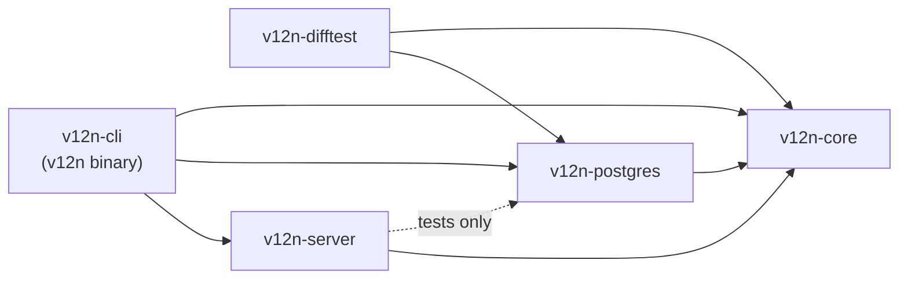
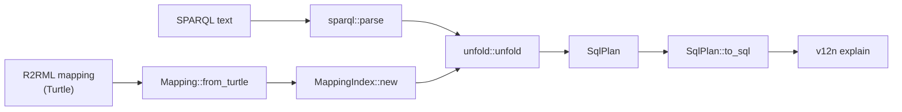
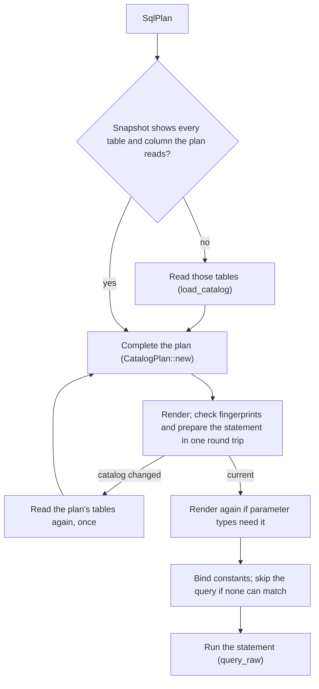
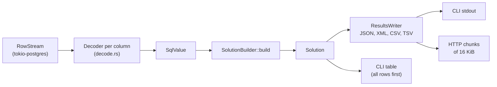
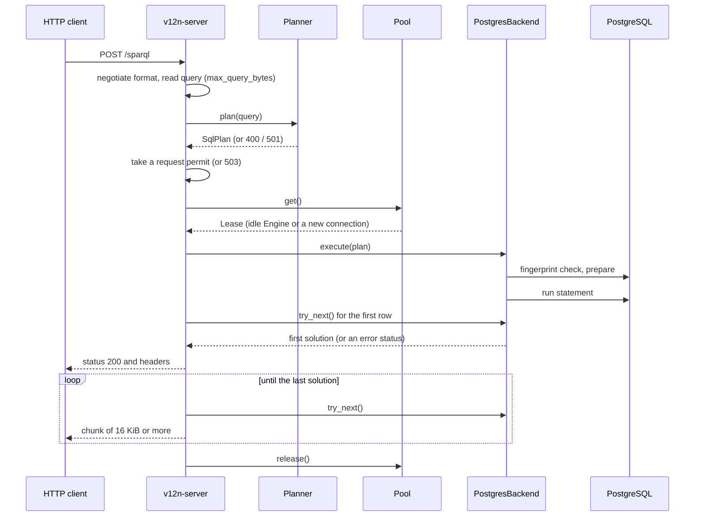

# Architecture

English | [한국어](architecture.ko.md) | [简体中文](architecture.zh-CN.md)

This document describes how the crates of sparql-v12n depend on each
other and what happens between a SPARQL query and its results: planning
without a database, the steps that read the database catalog, execution,
and the way rows become results. It describes the code on `main`; the
last section separates it from planned changes. Query semantics are in
[semantics.md](semantics.md), and commands and settings in
[usage.md](usage.md).

## Crates

The arrows are Cargo dependencies. The dashed arrow is a
`dev-dependency`: the server's tests run on PostgreSQL, but the server
itself is generic over the database.

| Crate | Responsibility | Entry points |
|---|---|---|
| `v12n-core` | Mapping model and index, SPARQL parsing, unfolding into `SqlPlan`, plan rewrites, SQL rendering, rows to solutions, result formats. No database driver and no async runtime | [`Planner`](../crates/v12n-core/src/planner.rs), [`Engine`](../crates/v12n-core/src/engine.rs), [`backend`](../crates/v12n-core/src/backend.rs) |
| `v12n-postgres` | The PostgreSQL adapter: connection and TLS, catalog reads, statement preparation, parameter binding, value decoding | [`PostgresConnector`](../crates/v12n-postgres/src/connector.rs), [`PostgresBackend`](../crates/v12n-postgres/src/lib.rs) |
| `v12n-server` | SPARQL 1.1 Protocol endpoint: request parsing, content negotiation, limits, the session pool, chunked responses | [`serve`](../crates/v12n-server/src/lib.rs), [`protocol`](../crates/v12n-server/src/protocol.rs), [`pool`](../crates/v12n-server/src/pool.rs) |
| `v12n-cli` | The `v12n` command: argument parsing, output formats, exit codes | [`main.rs`](../crates/v12n-cli/src/main.rs) |
| `v12n-difftest` | Differential tests: each case query runs through the library and through Ontop, and the results are compared | [`lib.rs`](../crates/v12n-difftest/src/lib.rs), [`engine.rs`](../crates/v12n-difftest/src/engine.rs) |

## Ports

`v12n-core` defines the boundary between the front ends and the
database as traits, and the other crates are adapters on either side of
it.

| Port | Kind | Role | Implemented by |
|---|---|---|---|
| `Planner` | Driving | Holds a mapping and its index; plans queries. Needs no database | `v12n-core` |
| `Engine<B>` | Driving | Pairs a shared `Planner` and `Catalog` with one database session `B`; completes, renders and executes plans | `v12n-core` |
| `Connector` | Driven | Opens a session with the query limits the front end passes | `PostgresConnector` |
| `Backend` | Driven | One session: its SQL dialect, `load_catalog`, `execute` of a `CatalogPlan`, `is_closed` | `PostgresBackend` |
| `SolutionStream` | Driven | The solutions of one query, read one at a time; reports truncation | `v12n_postgres::Solutions` |
| `BackendError` | Driven | Classifies an error as `Config`, `Database`, `Timeout`, `StaleCatalog` or `Core`, from which front ends choose exit codes and HTTP statuses | `v12n_postgres::Error` |
| `Dialect` | Driven | The SQL text that differs between databases | `PostgresDialect` |

Trait methods return `impl Future + Send`, so the front ends are generic
over a `Connector` and every call is dispatched statically.
`v12n-server` names no database type. In `v12n-cli`, only the
`connector` function in `main.rs` names `PostgresConnector`.

## Planning without a database

1. [`Mapping::from_turtle`](../crates/v12n-core/src/mapping.rs) parses
   the R2RML mapping. `with_base_iri` sets the base IRI that relative
   IRIs resolve against.
2. [`Planner::new`](../crates/v12n-core/src/planner.rs) builds the
   `MappingIndex`, which finds the triples maps that can produce a class
   or a property. It is built once per `Planner`.
3. [`Planner::plan`](../crates/v12n-core/src/planner.rs) calls
   [`sparql::parse`](../crates/v12n-core/src/sparql.rs), which turns the
   text into SPARQL algebra and refuses unsupported features, and
   [`unfold::unfold`](../crates/v12n-core/src/unfold.rs), which produces
   the `SqlPlan`. Each triple pattern becomes a scan of the logical
   tables of matching triples maps, shared variables become join
   conditions, `OPTIONAL` becomes `LEFT JOIN`, and each combination of
   candidate triples maps becomes one SQL branch of a `UNION ALL`. More
   than `MAX_BRANCHES` (64) branches is refused.
4. [`SqlPlan::to_sql`](../crates/v12n-core/src/sql/renderer.rs) renders
   the plan for PostgreSQL with no database information. `v12n explain`
   prints this SQL. It keeps every duplicate-removing step, since only
   table keys can show that one is unnecessary.

Errors at this stage are about the query or the mapping:
`QuerySyntax`, `UnsupportedFeature` and `TooManyBranches`.

## Steps that read the database

The SQL that runs is not the SQL of `v12n explain`. Keys, column types
and resolved column names come from a catalog snapshot
([`CatalogSnapshot`](../crates/v12n-core/src/catalog.rs)) that the
backend reads with `load_catalog`, and every query checks that the
database still matches it ([Discussion #187](https://github.com/CharmingGroot/sparql-v12n/discussions/187)).

- **Snapshot.** For each logical table: whether it exists, the columns
  the mapping reads with their resolved names, types and `NOT NULL`, the
  unique keys that hold for every row (valid, not deferrable, not
  partial, on plain columns, and not on a table with inheritance
  children), validated foreign keys, and a fingerprint: a SHA-256 hash,
  computed by PostgreSQL, of the catalog rows these come from.
  `v12n serve` reads the snapshot of every table of the mapping at
  startup; `v12n query` reads the tables of its plan only.
- **Completing the plan.**
  [`CatalogPlan::new`](../crates/v12n-core/src/catalog/plan.rs) runs in
  `v12n-core` without the database. It resolves column names that
  PostgreSQL folds to lower case. Keys show when a branch scans the same
  row twice, so the scans merge, and when the result cannot have
  duplicates, so `DISTINCT` or a duplicate-removing `UNION` is dropped.
  Column types decide how branches of a `UNION` line up and how values
  compare as RDF terms; a comparison that SQL cannot answer as SPARQL
  does fails with `UnsupportedFeature`. A table or column that the
  snapshot shows missing fails with `Catalog`.
- **Check.** [`PostgresBackend::run`](../crates/v12n-postgres/src/lib.rs)
  sends the fingerprint query for the plan's tables and the preparation
  of the statement in one pipelined round trip. A plan that reads an
  `rr:sqlQuery` also parses its probe there and compares the column
  names and types with the snapshot. When anything differs, the
  statement does not run: the engine reads those tables again and plans
  once more. A second difference is a retryable error (HTTP 503).
- **Parameters.** Every constant of the query is a bound parameter. The
  types PostgreSQL infers for them can change the SQL, for example a
  comparison that has to match the text output of a type without a
  decoder, so the statement is rendered and prepared a second time when
  needed. The connection remembers that SQL by the SQL rendered first,
  prepares it with the first statement next time, and uses it only when
  it is exactly the statement the types call for.
- **Row limit.** When the row limit can cut the result, the statement
  reads one row past the limit and carries `count(*) OVER ()` in an
  extra column, so that the first row tells whether the result is
  truncated.

The check and the execution are separate round trips, so a schema
change committed between them is not seen by that query.

## From rows to results

1. [`Solutions::try_next`](../crates/v12n-postgres/src/lib.rs) reads one
   row from the connection. On the first row it reads the row count, if
   the statement has one, and records whether the result is truncated.
2. A [`Decoder`](../crates/v12n-postgres/src/decode.rs) chosen from each
   column's PostgreSQL type reads the binary value into a `SqlValue`.
   Columns of types without a decoder are cast to text in SQL.
3. [`SolutionBuilder`](../crates/v12n-core/src/solution.rs) turns the
   values into RDF terms: the natural RDF literal of a SQL value (R2RML
   §10.2) and term generation from the projected term maps (R2RML §11).
4. [`ResultsWriter`](../crates/v12n-core/src/results.rs) writes each
   solution in the SPARQL 1.1 Query Results JSON, XML, CSV or TSV format.

The two front ends differ after the first row.

- `v12n query` waits for the first row before writing anything, so that
  an error in planning or early execution is reported in the chosen
  output format with its exit code. JSON, XML, CSV and TSV are then
  written to stdout one solution at a time. The `table` format collects
  every row first, because column widths depend on all of them; the row
  limit bounds how many that is.
- The HTTP endpoint also waits for the first row, so that an error can
  still become a status code. The status line and headers then go out,
  including `v12n-truncated` when the result is cut at the row limit.
  The body is written in chunks of at least 16 KiB. An error after the
  status line aborts the response without the terminating chunk, and
  JSON and XML stay unterminated, so a partial body cannot pass for a
  complete result.

## A query through each front end

`v12n query examples/shop/mapping.ttl examples/shop/queries/customers.rq --db …`

1. `load_plan` reads the mapping and the query, builds a `Planner` and
   calls `plan`.
2. `query` builds a single-threaded Tokio runtime and calls
   `PostgresConnector::connect`, which opens one connection and sets the
   statement timeout and read-only transactions for the session.
3. `Engine::execute` reads the catalog entries of the plan's tables,
   since the CLI starts with an empty catalog, completes the plan and
   calls `PostgresBackend::run`, which checks the entries, prepares and
   starts the statement, and returns `Solutions`.
4. `stream_solutions` or `print_solutions_table` reads the solutions to
   the end. A truncated result prints a warning and sets exit code 5
   after the output.

`POST /sparql` with the same query:

`serve` parses the mapping and builds the `Planner` at startup, then
opens one session to check that the database is reachable and reads the
catalog snapshot of the mapping's tables. Tables and columns that the
mapping reads and the database lacks are logged as warnings. Each request
goes through `answer` in [`lib.rs`](../crates/v12n-server/src/lib.rs).
A planning error returns before a permit or a connection is taken.

## Lifetimes, ownership and limits

**Mapping and index.** A `Planner` lives as long as the process: one per
`v12n` run, and one for the server, shared by every request through an
`Arc`. A changed mapping file takes effect after a restart.

**Catalog snapshot.** The server holds one `Catalog`, shared by the
sessions of the pool. A reload replaces the entries of the tables it
read for the queries that start after it; a running query keeps the
snapshot it started with. `v12n query` starts with an empty catalog.

**Connections.** `v12n query` opens one connection and closes it on
exit. The server keeps idle `Engine`s in a pool and opens a new one when
none is idle. The request permit bounds how many are in use, so the pool
has no size limit of its own. A session goes back to the pool only after
its result was read to the end. When a response is aborted or the client
disconnects, the session is dropped instead and its connection closes,
because a statement may still be running on it. Closing the connection
does not send a cancel request; PostgreSQL stops the statement once it
notices that the connection is closed, and `statement_timeout` bounds
it in any case.

**Limits.**

| Limit | Where it applies | Effect |
|---|---|---|
| `statement_timeout` | PostgreSQL session setting | The server cancels the statement; before the first row this is exit code 4 or HTTP 503 |
| Read-only transactions | PostgreSQL session setting | An `rr:sqlQuery` cannot change data |
| `row_limit` | Statement and `Solutions` | At most this many solutions; the result is marked truncated |
| `max_query_bytes` | HTTP request | 413 for `POST`, 414 for `GET` |
| `max_concurrent_requests` | Server semaphore | Further requests get 503 with `Retry-After`; nothing is queued |
| `MAX_BRANCHES` | Unfolding | A query that unfolds into more branches is refused |
| `connect_timeout` | Connection | 10 seconds unless the connection string sets one |

Defaults and settings are in [usage.md](usage.md#http-endpoint).

**Memory.** The application streams solutions one at a time in every
format except `table`, and the server holds at most one chunk of output
per response. This does not make query execution constant in memory.
PostgreSQL sorts for `ORDER BY` and `DISTINCT`, builds joins, and, when
the row limit can cut the result, materializes up to `row_limit + 1`
rows for `count(*) OVER ()` before it sends the first one
([#152](https://github.com/CharmingGroot/sparql-v12n/issues/152)).

## Implemented and planned

| Change | Status |
|---|---|
| `Dialect` trait for database-specific SQL ([#134](https://github.com/CharmingGroot/sparql-v12n/issues/134)) | Implemented; `PostgresDialect` is the only dialect |
| `Engine`, `Backend`, `Connector`, `SolutionStream` ports ([#166](https://github.com/CharmingGroot/sparql-v12n/issues/166)) | Implemented; `v12n-postgres` is the only adapter |
| Catalog reads as a snapshot taken by the engine instead of inside `PostgresBackend::run` ([#109](https://github.com/CharmingGroot/sparql-v12n/issues/109), [#110](https://github.com/CharmingGroot/sparql-v12n/issues/110), [Discussion #187](https://github.com/CharmingGroot/sparql-v12n/discussions/187)) | Implemented |
| Ontology support ([#123](https://github.com/CharmingGroot/sparql-v12n/issues/123)–[#127](https://github.com/CharmingGroot/sparql-v12n/issues/127)) | Planned |
| A second database ([#165](https://github.com/CharmingGroot/sparql-v12n/issues/165)) | Planned |
| Truncation without materializing the limited rows ([#152](https://github.com/CharmingGroot/sparql-v12n/issues/152)) | Open; decided after measurement |
