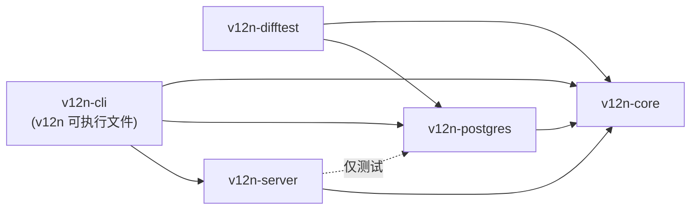
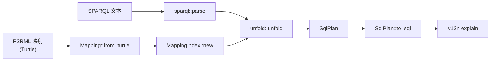
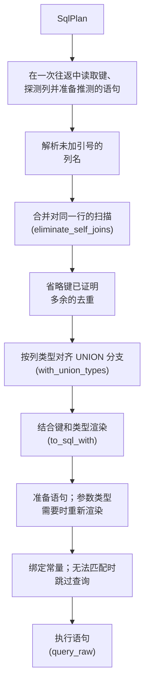
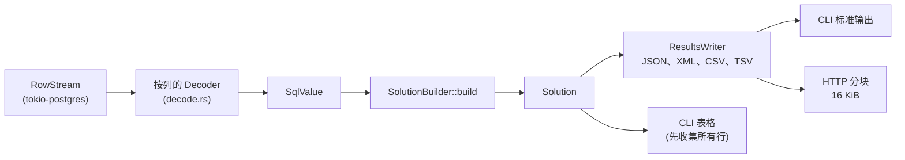
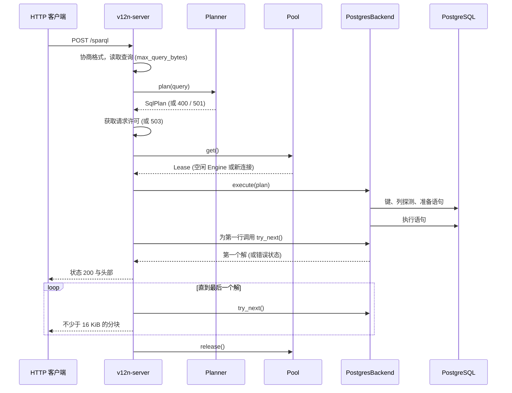

# 架构

[English](architecture.md) | [한국어](architecture.ko.md) | 简体中文

> 本文是 [architecture.md](architecture.md)（于 #186 中新增）的翻译。如有出入，以英文原文为准。

本文介绍 sparql-v12n 各 crate 之间的依赖关系，以及 SPARQL 查询变为结果所经历的步骤：不访问数据库的查询规划、读取数据库目录的步骤、执行，以及行如何变为结果。本文描述 `main` 分支上的代码，最后一节将其与计划中的变更区分开。查询的回答规则见 [semantics.zh-CN.md](semantics.zh-CN.md)，命令与设置见 [usage.zh-CN.md](usage.zh-CN.md)。

## Crate

箭头表示 Cargo 依赖。虚线箭头是 `dev-dependency`：服务器的测试在 PostgreSQL 上运行，但服务器本身对数据库是泛型的。

| Crate | 职责 | 入口 |
|---|---|---|
| `v12n-core` | 映射模型与索引、SPARQL 解析、展开为 `SqlPlan`（unfold）、计划重写、SQL 渲染、将行转换为解、结果格式。不依赖数据库驱动和异步运行时 | [`Planner`](../crates/v12n-core/src/planner.rs)、[`Engine`](../crates/v12n-core/src/engine.rs)、[`backend`](../crates/v12n-core/src/backend.rs) |
| `v12n-postgres` | PostgreSQL 适配器：连接与 TLS、目录查询、语句准备、参数绑定、值解码 | [`PostgresConnector`](../crates/v12n-postgres/src/connector.rs)、[`PostgresBackend`](../crates/v12n-postgres/src/lib.rs) |
| `v12n-server` | SPARQL 1.1 Protocol 端点：请求解析、内容协商、限制、会话池、分块响应 | [`serve`](../crates/v12n-server/src/lib.rs)、[`protocol`](../crates/v12n-server/src/protocol.rs)、[`pool`](../crates/v12n-server/src/pool.rs) |
| `v12n-cli` | `v12n` 命令：参数解析、输出格式、退出码 | [`main.rs`](../crates/v12n-cli/src/main.rs) |
| `v12n-difftest` | 差分测试：每个用例的查询分别通过本库和 Ontop 执行，并比较结果 | [`lib.rs`](../crates/v12n-difftest/src/lib.rs)、[`engine.rs`](../crates/v12n-difftest/src/engine.rs) |

## 端口

`v12n-core` 以 trait 的形式定义前端与数据库之间的边界，其余 crate 是边界两侧的适配器。

| 端口 | 类型 | 职责 | 实现 |
|---|---|---|---|
| `Planner` | 驱动（driving） | 持有映射及其索引，规划查询。不需要数据库 | `v12n-core` |
| `Engine<B>` | 驱动（driving） | 将共享的 `Planner` 与一个数据库会话 `B` 组合，渲染并执行计划 | `v12n-core` |
| `Connector` | 被驱动（driven） | 以前端传入的查询限制打开会话 | `PostgresConnector` |
| `Backend` | 被驱动（driven） | 一个会话：SQL 方言、`execute`、`is_closed` | `PostgresBackend` |
| `SolutionStream` | 被驱动（driven） | 逐个读取一个查询的解，并报告结果是否被截断 | `v12n_postgres::Solutions` |
| `BackendError` | 被驱动（driven） | 将错误分类为 `Config`、`Database`、`Timeout` 或 `Core`，前端据此决定退出码和 HTTP 状态码 | `v12n_postgres::Error` |
| `Dialect` | 被驱动（driven） | 各数据库之间不同的 SQL 文本 | `PostgresDialect` |

trait 方法返回 `impl Future + Send`，因此前端对 `Connector` 是泛型的，所有调用都是静态分派。`v12n-server` 不引用任何数据库类型。在 `v12n-cli` 中，只有 `main.rs` 的 `connector` 函数引用 `PostgresConnector`。

## 不访问数据库的查询规划

1. [`Mapping::from_turtle`](../crates/v12n-core/src/mapping.rs) 解析 R2RML 映射。`with_base_iri` 设置解析相对 IRI 所用的基础 IRI。
2. [`Planner::new`](../crates/v12n-core/src/planner.rs) 构建 `MappingIndex`，用于查找能产生某个类或属性的 triples map。每个 `Planner` 只构建一次。
3. [`Planner::plan`](../crates/v12n-core/src/planner.rs) 依次调用 [`sparql::parse`](../crates/v12n-core/src/sparql.rs) 和 [`unfold::unfold`](../crates/v12n-core/src/unfold.rs)。前者将文本转换为 SPARQL 代数并拒绝不支持的功能，后者生成 `SqlPlan`。每个三元组模式成为对匹配 triples map 的逻辑表的扫描，共享变量成为连接条件，`OPTIONAL` 成为 `LEFT JOIN`，候选 triples map 的每种组合成为 `UNION ALL` 中的一个 SQL 分支。分支超过 `MAX_BRANCHES`（64）个时拒绝。
4. [`SqlPlan::to_sql`](../crates/v12n-core/src/sql/renderer.rs) 在没有数据库信息的情况下为 PostgreSQL 渲染计划。`v12n explain` 输出的就是这段 SQL。由于只有表的键才能说明某个去重步骤是多余的，这段 SQL 保留所有去重步骤。

这一阶段的错误来自查询或映射：`QuerySyntax`、`UnsupportedFeature` 和 `TooManyBranches`。

## 读取数据库的步骤

实际执行的 SQL 与 `v12n explain` 的 SQL 不同。执行计划之前，后端从数据库读取 `v12n-core` 的重写函数和渲染器所需的信息。这些步骤位于 [`PostgresBackend::run`](../crates/v12n-postgres/src/lib.rs)，每个查询都会执行。

- **键。** 通过目录查询读取计划中可利用键的表的唯一键。只使用对每一行始终成立的键：有效、不可延迟、非部分索引、建在普通列上，且所在表没有继承子表。借助键可以判断一个分支是否两次扫描同一行，从而合并扫描；也可以判断结果不会有重复，从而省略 `DISTINCT` 或去重的 `UNION`。
- **列名与类型。** 一条探测语句解析被 PostgreSQL 转为小写的列名，并报告列类型。类型决定 `UNION` 各分支如何对齐，以及值如何作为 RDF 项比较。对于这些类型 SQL 无法给出与 SPARQL 相同答案的比较，会在此以 `UnsupportedFeature` 失败。
- **参数。** 查询中的每个常量都是绑定参数。PostgreSQL 为参数推断的类型可能改变 SQL，例如需要与没有解码器的类型的文本输出进行比较。此时语句会重新渲染并再次准备。
- **行数限制。** 当行数限制可能截断结果时，语句比限制多读取一行，并在额外的一列中带上 `count(*) OVER ()`，这样第一行就能说明结果是否被截断。

重写和渲染函数位于 `v12n-core`，都是纯函数；何时依据目录信息调用它们由后端决定。从目录读取的信息不会在查询之间保留。连接只记住为最近的计划准备的语句的 SQL 文本，并且只有当它与根据最新信息生成的语句相同时才使用。

## 从行到结果

1. [`Solutions::try_next`](../crates/v12n-postgres/src/lib.rs) 从连接读取一行。如果语句带有行数列，则在第一行读取该值，并记录结果是否被截断。
2. 根据每列的 PostgreSQL 类型选择的 [`Decoder`](../crates/v12n-postgres/src/decode.rs) 将二进制值读取为 `SqlValue`。没有解码器的类型的列在 SQL 中转换为文本。
3. [`SolutionBuilder`](../crates/v12n-core/src/solution.rs) 将值转换为 RDF 项：SQL 值的自然 RDF 字面量（R2RML §10.2），以及根据投影的 term map 生成项（R2RML §11）。
4. [`ResultsWriter`](../crates/v12n-core/src/results.rs) 以 SPARQL 1.1 Query Results JSON、XML、CSV 或 TSV 格式逐个写出解。

两个前端在第一行之后的处理不同。

- `v12n query` 在收到第一行之前不输出任何内容，因此规划或执行初期的错误能以所选输出格式和对应退出码报告。之后 JSON、XML、CSV 和 TSV 逐个解写入标准输出。`table` 格式需要所有行才能确定列宽，因此先收集所有行；收集的行数以行数限制为上限。
- HTTP 端点同样等待第一行，因此在此之前的错误仍能成为状态码。随后发送状态行和头部；当结果在行数限制处被截断时附带 `v12n-truncated` 头部。响应体以不少于 16 KiB 的分块写出。状态行之后发生的错误会中止响应且不发送终止分块，JSON 和 XML 保持未闭合，因此不完整的响应体不会被当作完整结果。

## 查询在各前端中的路径

`v12n query examples/shop/mapping.ttl examples/shop/queries/customers.rq --db …`

1. `load_plan` 读取映射和查询，构建 `Planner` 并调用 `plan`。
2. `query` 构建单线程 Tokio 运行时并调用 `PostgresConnector::connect`，后者打开一个连接，并为会话设置语句超时和只读事务。
3. `Engine::execute` 调用 `PostgresBackend::run`，后者执行读取数据库的步骤并返回 `Solutions`。
4. `stream_solutions` 或 `print_solutions_table` 读取全部解。结果被截断时，在输出之后打印警告并以退出码 5 结束。

以 `POST /sparql` 发送同一查询：

`serve` 在启动时解析映射并构建 `Planner`，然后打开一个会话以确认数据库可达。每个请求由 [`lib.rs`](../crates/v12n-server/src/lib.rs) 中的 `answer` 处理。规划错误在获取请求许可或连接之前返回。

## 生命周期、所有权与限制

**映射与索引。** `Planner` 与进程同生命周期：每次运行 `v12n` 有一个，服务器有一个，并通过 `Arc` 由所有请求共享。修改映射文件后需重启才能生效。

**连接。** `v12n query` 打开一个连接，并在退出时关闭。服务器将空闲的 `Engine` 保存在池中，没有空闲会话时新建一个。使用中的会话数由请求许可数限制，因此池本身没有大小限制。会话只有在结果被读完后才回到池中。响应中止或客户端断开时，会话不会回到池中而是被丢弃，其连接随之关闭，因为该连接上可能仍有语句在执行。关闭连接时不会发送取消请求；PostgreSQL 在察觉连接已关闭时停止该语句，无论如何 `statement_timeout` 都是其执行时间的上限。

**限制。**

| 限制 | 作用位置 | 效果 |
|---|---|---|
| `statement_timeout` | PostgreSQL 会话设置 | 服务器取消语句；若在第一行之前，则为退出码 4 或 HTTP 503 |
| 只读事务 | PostgreSQL 会话设置 | `rr:sqlQuery` 无法修改数据 |
| `row_limit` | 语句与 `Solutions` | 最多返回这么多个解，并将结果标记为已截断 |
| `max_query_bytes` | HTTP 请求 | `POST` 为 413，`GET` 为 414 |
| `max_concurrent_requests` | 服务器信号量 | 超出的请求收到带 `Retry-After` 的 503，不排队 |
| `MAX_BRANCHES` | 展开（unfold） | 展开后分支更多的查询被拒绝 |
| `connect_timeout` | 连接 | 连接字符串未设置时为 10 秒 |

默认值与设置方法见 [usage.zh-CN.md](usage.zh-CN.md#http-端点)。

**内存。** 除 `table` 外，应用在所有格式中逐个流式输出解，服务器每个响应最多只持有一个输出分块。但这并不意味着整个查询执行只占用恒定内存。PostgreSQL 会为 `ORDER BY` 和 `DISTINCT` 排序并构建连接；当行数限制可能截断结果时，它在发送第一行之前会为 `count(*) OVER ()` 物化最多 `row_limit + 1` 行（[#152](https://github.com/CharmingGroot/sparql-v12n/issues/152)）。

## 已实现与计划中

| 变更 | 状态 |
|---|---|
| 用于数据库专用 SQL 的 `Dialect` trait（[#134](https://github.com/CharmingGroot/sparql-v12n/issues/134)） | 已实现；`PostgresDialect` 是唯一的方言 |
| `Engine`、`Backend`、`Connector`、`SolutionStream` 端口（[#166](https://github.com/CharmingGroot/sparql-v12n/issues/166)） | 已实现；`v12n-postgres` 是唯一的适配器 |
| 由引擎获取目录快照，而不是在 `PostgresBackend::run` 内读取目录（[#109](https://github.com/CharmingGroot/sparql-v12n/issues/109)、[#110](https://github.com/CharmingGroot/sparql-v12n/issues/110)） | 计划中 |
| 本体支持（[#123](https://github.com/CharmingGroot/sparql-v12n/issues/123)–[#127](https://github.com/CharmingGroot/sparql-v12n/issues/127)） | 计划中 |
| 第二种数据库（[#165](https://github.com/CharmingGroot/sparql-v12n/issues/165)） | 计划中 |
| 不物化受限行即可报告截断（[#152](https://github.com/CharmingGroot/sparql-v12n/issues/152)） | 未定；测量后决定 |
